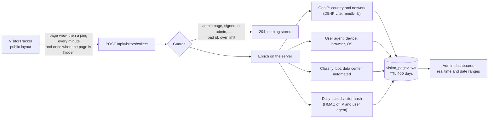
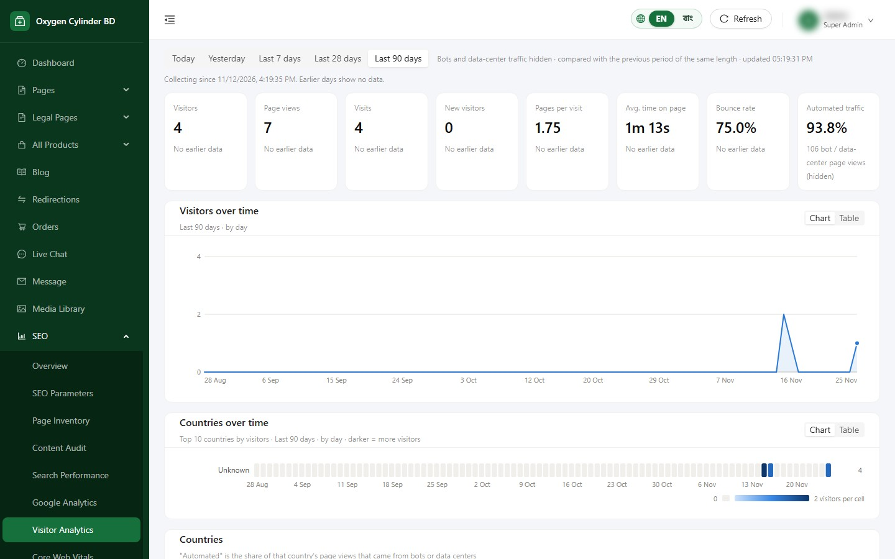
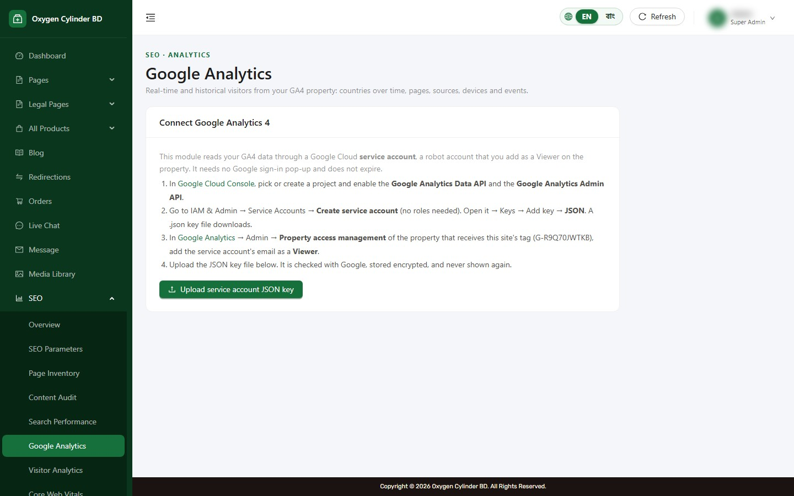

# Analytics

> Two complementary views of traffic: a first-party, privacy-first visitor analytics module built into the application, and a Google Analytics 4 dashboard inside the admin panel. [Back to the overview](../README.md)

## Contents

- [Why two analytics systems](#why-two-analytics-systems)
- [First-party visitor analytics](#first-party-visitor-analytics)
- [Privacy design](#privacy-design)
- [Bot and data-center classification](#bot-and-data-center-classification)
- [The visitor dashboard](#the-visitor-dashboard)
- [Google Analytics 4 in the admin panel](#google-analytics-4-in-the-admin-panel)
- [Search Console and PageSpeed](#search-console-and-pagespeed)
- [Charts](#charts)

## Why two analytics systems

In early November 2026, GA4 reported a surge of "visitors from Singapore" with zero engagement. Server logs traced them to automated traffic from large cloud-hosting networks. GA4 couldn't separate that traffic, and it can't be audited against server reality.

The owner asked for analytics **without a Google Cloud dependency** that would show live visitors by country and make bot traffic visible and separable. The result is a built-in module. GA4 stays in place for continuity, and both dashboards share one set of chart components.

| | First-party visitor analytics | Google Analytics 4 |
| --- | --- | --- |
| Collection | Same-origin beacon to the application | Google tag |
| Cookies | None | GA cookies |
| IP addresses | Never stored | Processed by Google |
| Bot and data-center traffic | Classified and hideable | Mixed in |
| Real time | Last 30 minutes, refreshed every 30 seconds | GA4 real-time API |
| Retention | 400 days (TTL index) | GA4 property settings |
| Setup | None | A service-account key uploaded in the admin panel |

## First-party visitor analytics

| Endpoint rule | Detail |
| --- | --- |
| Response | Always `204 No Content`, so collection can never slow down or break a page |
| Origin | Same-origin requests only |
| Rate limit | 120 per minute per client |
| Body | At most 4 KB |
| Identifiers | Page-view and session ids must be well-formed, or the event is dropped silently |
| Excluded | `/admin`, `/api` and `/_next` paths, and visits by signed-in admins |
| Engagement | Visible time on the page is reported by a ping every minute and once when the page is hidden |

Each stored page view contains: time, Dhaka-local day, page-view and session ids, the hashed visitor id, a new-visitor flag, path, referrer host, UTM campaign values, country, network (ASN and organization), device, browser, operating system, bot / data-center / automated flags, language, screen width and engaged duration.

## Privacy design

- **No IP address is stored.** The visitor id is an HMAC of the IP address and user agent with a **salt that changes daily**. It counts unique visitors within a day, but can't be reversed or linked across days.
- **No cookies** are set for analytics.
- **Data expires automatically.** A TTL index removes page views after 400 days.
- **Real client addresses** are only trusted from the edge and the reverse proxy, which overwrite incoming forwarding headers. A visitor can't spoof the address used for the hash or the rate limit.
- **GeoIP stays local.** The country and network databases are read from disk on the server and re-downloaded automatically if they go missing. No lookup leaves the server.

## Bot and data-center classification

| Signal | Classification |
| --- | --- |
| Known crawler and automation user agents (including headless browsers) | `bot` |
| Networks that belong to cloud-hosting providers (a curated ASN set plus organization-name patterns) | `dc` (data center) |
| Either of the above | `automated` |
| Privacy relays (for example, a browser's private relay service) | Exempt: they are real people behind a relay network |

The dashboard's **Hide bots & data-center traffic** switch is on by default. Automated traffic is never deleted. Its share is shown next to the other key figures (for example "93.8% automated: 106 bot or data-center page views hidden" in the development data pictured below), so the team can see what it is filtering out.

## The visitor dashboard

| Section | Contents |
| --- | --- |
| Real time (last 30 minutes) | Visitors in the last 30 and 5 minutes, visitors per minute, countries right now, a minute-by-minute country heatmap, live activity (time, country, page, device, network), pages being viewed, devices |
| Date ranges | Today, yesterday, last 7, 28 and 90 days, each compared with the previous period of the same length |
| Key figures | Visitors, page views, visits, new visitors, pages per visit, average time on page, bounce rate, automated share |
| Trends | Visitors over time; countries over time as a heatmap; each with a table view |
| Breakdowns | Countries (with automated share), top pages, traffic sources (referring sites, with direct traffic shown separately), devices, browsers, operating systems, networks, UTM campaigns |

Days and hours are calculated in Dhaka time, the business's time zone.

The dashboard home page shows a compact version of the same data.

## Google Analytics 4 in the admin panel

| Decision | Reason |
| --- | --- |
| **Service account, not OAuth** | OAuth refresh tokens issued to apps in testing mode expire after seven days. A service account added to the GA4 property as a Viewer doesn't expire and needs no sign-in pop-up |
| Key handling | The JSON key is uploaded once in the admin panel, checked with Google, stored **encrypted**, and never shown again |
| Property selection | The module picks the GA4 property whose web stream matches the site's measurement id |
| APIs | Analytics Data API for reports, Analytics Admin API for property discovery |
| Reports | Real-time and historical: countries over time, pages, sources, devices and events |

Setup is four steps, shown on the screen above: enable the two APIs, create a service account and key, add the service account as a Viewer on the property, and upload the key.

## Search Console and PageSpeed

- **Search Console** connects through OAuth. Tokens are stored encrypted and used only server-side. Reports cover clicks, impressions, CTR and position, and Publication Results joins them with the site's eligible URLs.
- **PageSpeed Insights** runs are started by a staff member for a chosen page and strategy (mobile or desktop). Each run is saved with performance, SEO, accessibility and best-practice scores and LCP, CLS, INP, FCP, TTFB and TBT, so trends are visible over time.

## Charts

All analytics charts are SVG components shared by the visitor and GA4 dashboards. They size themselves with `ResizeObserver`, and their colour palette was checked with a palette validator for contrast and for distinguishability between series. Trend charts can switch to a table view for exact values.
