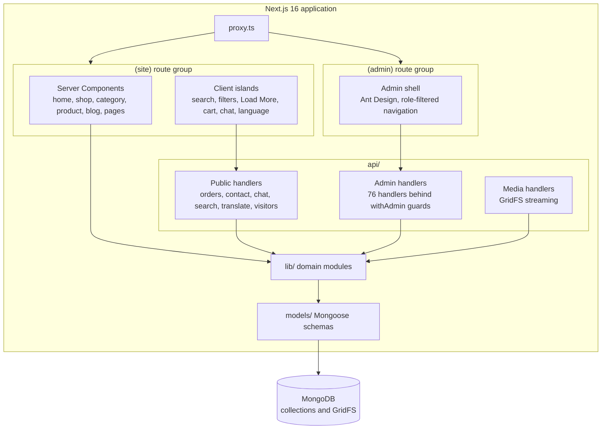
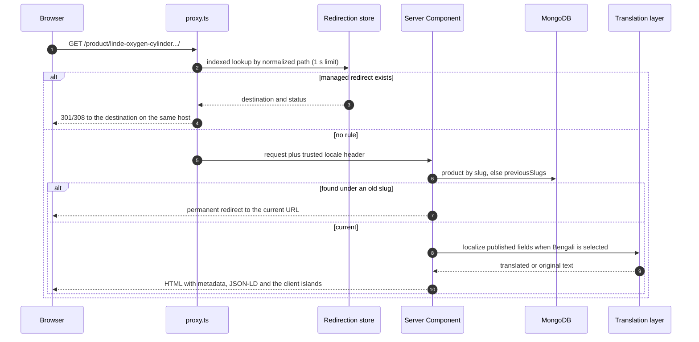
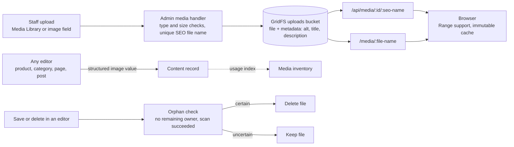

# Architecture

> How the private application is put together and why. [Back to the overview](../README.md)

This document describes module boundaries, data flow and design decisions. It names real modules so a reviewer can follow the reasoning. It does not include source code, endpoint contracts, server addresses or credentials.

## Contents

- [Shape of the system](#shape-of-the-system)
- [Route groups and layouts](#route-groups-and-layouts)
- [Rendering model](#rendering-model)
- [Request lifecycle](#request-lifecycle)
- [The proxy layer](#the-proxy-layer)
- [Data access](#data-access)
- [Module boundaries](#module-boundaries)
- [Media pipeline](#media-pipeline)
- [Client state](#client-state)
- [Key design decisions](#key-design-decisions)

## Shape of the system

Oxygen Cylinder BD is one Next.js 16 App Router application. One process serves:

- the public storefront and content pages,
- the guest cart, checkout and order API,
- the admin panel (44 page routes, including sign-in),
- JSON APIs for the admin panel, search, chat, contact enquiries, translation and analytics,
- media files streamed from MongoDB GridFS,
- `sitemap.xml` and `robots.txt`.

Keeping everything in one application was a deliberate choice for a small team. There is one deploy, one set of models, and one place to validate a product URL or an image value. There is no service-to-service contract to keep in sync.

## Route groups and layouts

| Group | Purpose | Layout responsibilities |
| --- | --- | --- |
| `(site)` | Public pages | Roboto and Hind Siliguri fonts, language and category-URL providers, the menu resolved from the live catalogue, site settings and footer content, guest cart and cart drawer, floating chat, mobile contact bar, visitor beacon, GA tag |
| `(site)/(inner)` | Every public page except the home page | Organizational group that shares the site layout |
| `(admin)` | Admin root, including the sign-in page | Ant Design registry, admin theme, admin fonts and a separate admin language scope |
| `(admin)/admin/(protected)` | The admin panel | Server-side session check (redirects to sign-in), admin shell with the role label and capabilities, role-filtered sidebar |

The admin layout loads no public-site chrome, and the public layout never loads Ant Design. The two experiences share models and domain modules, but none of their UI code.

## Rendering model

Public pages read MongoDB in Server Components and render **per request** (`dynamic = 'force-dynamic'`). Cloudflare passes pages through without caching them; page responses report `cf-cache-status: DYNAMIC`.

| Concern | Decision | Reason |
| --- | --- | --- |
| Freshness | Render pages per request | Staff edit prices, stock and copy all day. A save must be visible at once, without cache invalidation steps |
| Metadata | Server-side `generateMetadata()` from the same record the page renders | The title, description, canonical URL and robots directives can never disagree with the page |
| Redirects and 404s | Decided on the server before rendering | A retired slug returns a permanent redirect, never a page with stale content |
| Interactivity | Small client islands | Filters, Load More, search suggestions, the gallery, the cart and chat hydrate; the rest is server HTML |
| Static assets and media | Long-lived caching | Media responses use `Cache-Control: public, max-age=31536000, immutable` |
| Sitemap and robots | Generated per request with query time limits | A slow database can never fail a production build |

Rendering per request is cheap enough here. Queries only load the fields a page needs, the hot paths are indexed, and the catalogue holds a few hundred products.

## Request lifecycle

When nothing matches, the catch-all route asks `resolveUnmatchedPublicPath()` before returning a 404. It checks the legacy WordPress address map, historic root-level blog, product and category slugs, and the strict legacy product-slug matcher (see [the migration case study](WORDPRESS_MIGRATION.md)).

## The proxy layer

`src/proxy.ts` is the Next.js 16 request proxy (the framework's renamed middleware). It does three things and keeps each one cheap:

1. **Admin page gate.** It verifies the session cookie and applies the role's page allowlist. A signed-in admin who opens `/admin/login` goes to their start page. A role that opens a section outside its permissions lands on its own start page. The proxy is only a fast gate: every admin route handler verifies the same token again, because a proxy must never be the only authorization boundary.
2. **Managed redirects.** For public paths it makes one indexed lookup in the `redirections` collection, with a 1-second query limit. The destination must stay on the same host, use an allowed status (301, 302, 307 or 308), and must not point back to the source. Hit counts are updated after the response is sent (`event.waitUntil`) and skipped for prefetch requests. A broken or slow redirect store never takes the site down: errors are logged and the request continues.
3. **Language routing.** It reads the saved language cookie and passes the locale to the page in a request header the browser can't set. Old `/bn/…` and `/en/…` links get a 308 to the clean URL, and the visitor's language is remembered in the cookie. The response sets `Vary: Cookie`. A WordPress-era search (`/?s=oxygen`) is redirected to the shop search.

The matcher skips `/api`, `/_next`, static assets, media, `robots.txt` and `sitemap.xml`, so those requests never run the proxy.

## Data access

| Concern | Implementation |
| --- | --- |
| Connection | One Mongoose connection cached on `globalThis` (survives module reloads); `bufferCommands: false`; pool size and timeouts validated by a Zod environment schema |
| Development and production | Development uses MongoDB Atlas; production uses MongoDB 8 on the server. They are separate databases, and production content is never overwritten by a code release |
| Transactions | Production MongoDB is standalone. `withOptionalTransaction()` uses a transaction where one is available and falls back to a guarded sequence where it isn't |
| Indexes | Compound indexes for the storefront's hot paths (published + category + order + date), slug and previous-slug lookups, text search on product name and summary, and the idempotency key on orders |
| Field selection | List pages and the sitemap registry select route and publication fields only; bodies and images are not loaded |
| Native driver | Analytics aggregation, public asset metadata and GridFS use the MongoDB driver directly where Mongoose adds nothing |

## Module boundaries

`src/lib` holds 118 modules. The main groups:

| Group | Representative modules | Responsibility |
| --- | --- | --- |
| Identity and access | `admin-access`, `admin-accounts`, `admin-auth`, `admin-password`, `admin-token`, `request-security` | Roles and page allowlists, account configuration, sessions, scrypt hashing, rate limits, bounded JSON bodies |
| Catalogue | `productCategories`, `productCategoryOrder`, `productListing`, `productUrl`, `categoryUrlAliases`, `rentalTiers`, `shopPage` | Category rules, ordering within categories, filters and sorting, canonical URLs, rental packages, the default All Products category |
| Ordering | `orderPlacement`, `orderRules`, `orderEmail`, `orderWhatsApp` | Rebuilding orders from the catalogue, the status lifecycle, notifications, the WhatsApp message |
| Content | `contentBlocks`, `contentImport`, `contentDraft`, `contentTableOfContents`, `inlineLinks`, `inlineLinkValidation`, `managedPageContent` | Block documents, paste import, drafts, contents tables, safe inline links, managed page defaults |
| Media | `gridfs`, `imageMeta`, `mediaFileReferences`, `orphanMediaCleanup`, `adminMediaInventory`, `publicAssetMetadata` | Storage and streaming, structured image values, usage tracking, safe cleanup, inventory |
| URL continuity | `redirections`, `redirectTargets`, `legacyProductSlugs`, `seo/legacyWordPressUrls`, `seo/resolveUnmatchedPublicPath` | Managed redirects, recovery targets, WordPress-era addresses |
| SEO | `seo/indexablePageRegistry`, `seo/pageSchemas`, `seo/customSchema`, `seo/structuredDataConfig`, `seo/robotsDirectives`, `seo/pageSharing` | Indexability, JSON-LD builders, custom schema, crawler policy, Open Graph |
| Localization | `translation/engine`, `translation/catalog`, `translation/server`, `translation/google` | Provider-agnostic engine, allowlist, localizing published data, provider adapter |
| Analytics | `visitors/store`, `visitors/classify`, `visitors/geo`, `visitors/dashboard`, `seo/googleAnalytics`, `seo/googleServiceAccount` | First-party beacon store and reports, GA4 via a service account |
| Admin support | `adminProblemGuide`, `dashboard`, `projectAudit`, `siteSettings` | Explanations for error modals, dashboard counters, read-only audits, site-wide settings |

Sixteen modules import `server-only`, so the build fails if one of them is pulled into a client bundle by mistake.

## Media pipeline

- **Structured image values.** Images are stored as `{ src, alt, title, description, fileName }` rather than bare URLs. Helpers turn that value into an ``, Open Graph fields, JSON-LD or CSS, so a structured object never ends up in a `src` attribute.
- **One set of details per image.** Alt text, title and description live on the media record. Editors load the record, save typed changes with a revision check, and the server copies the change into every page that uses the image. A stale form can't undo a newer edit.
- **Range requests.** The media route answers `Range` requests with `206 Partial Content`, so self-hosted video plays and seeks on iOS Safari. Non-ASCII file names use an RFC 6266 `Content-Disposition` header.
- **Safe cleanup.** After a save or delete, public files that no owner references any more are removed in bounded batches. Any failed or uncertain scan keeps the file. Bundled static assets and private attachments can't reach this path.

## Client state

| State | Where it lives | Why |
| --- | --- | --- |
| Cart | React context persisted to `localStorage` under a versioned key | Guest checkout needs no server session. Old saved carts are checked against current category rules, so a stale cart can't submit an invalid option |
| Language | Cookie plus a React provider; separate public and admin cookies | The server must know the language before rendering, and staff language choices don't affect the public site |
| Listing filters | URL query parameters | Filtered views can be shared, bookmarked and crawled |
| Chat session | `localStorage` key for an anonymous session | A visitor can continue a conversation after reloading the page |

## Key design decisions

| Decision | Alternatives considered | Outcome |
| --- | --- | --- |
| Next.js App Router over a headless WordPress front end | Keep WordPress and theme it; a separate API service | One codebase that owns data, URLs and SEO; WordPress retired |
| Per-request rendering | Static generation with revalidation | Simpler and always current; performance comes from lean queries and small client bundles instead |
| MongoDB with GridFS for media | Object storage, or the file system | Media is backed up and restored with the data it belongs to; no second storage system to secure |
| Structured content blocks | Storing editor HTML | Content stays searchable, scoreable and safe; layout stays under the theme's control |
| One URL per page for both languages | `/bn/…` routes | No duplicate pages to canonicalize; the old `/bn` links redirect |
| Environment-defined admin accounts | A users collection with self-service sign-up | Little to attack; the panel has a handful of known staff |
| First-party analytics beside GA4 | GA4 only | Bot traffic is visible and separable; no cookie banner needed for the first-party data |
| Guest ordering only | Customer accounts and card payments | Matches how customers in this market buy: confirmation by phone or WhatsApp, cash on delivery |
