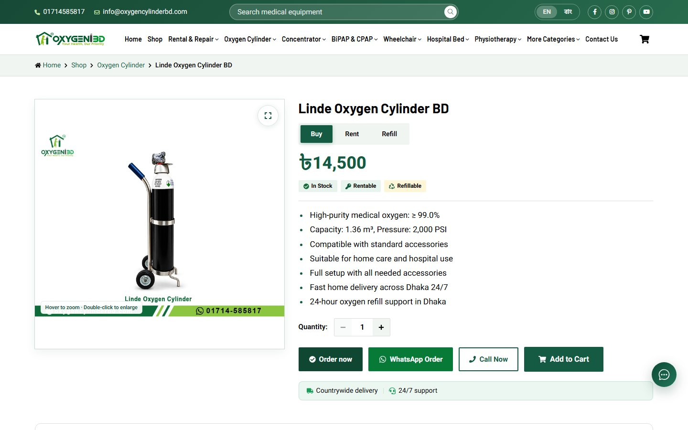
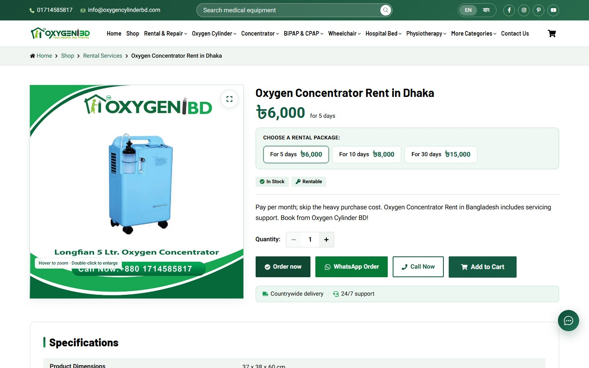
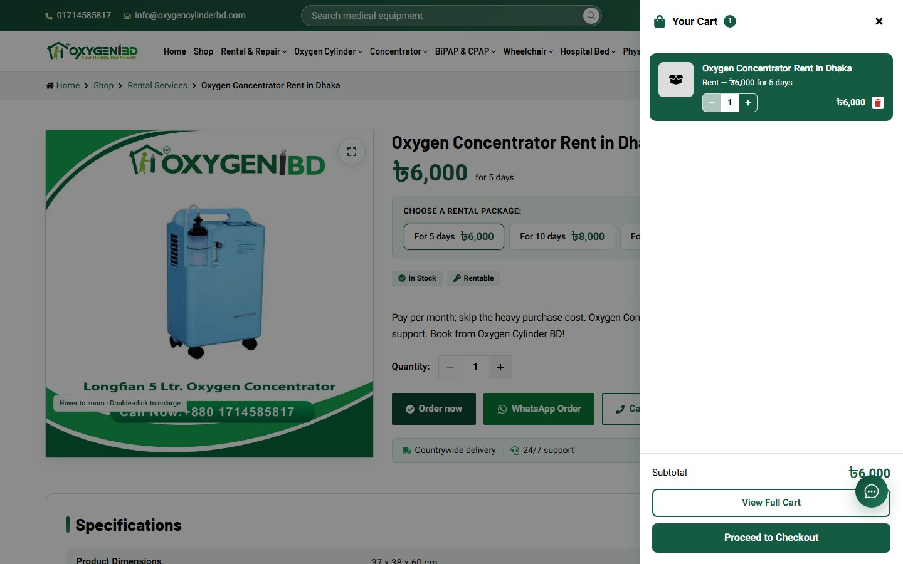
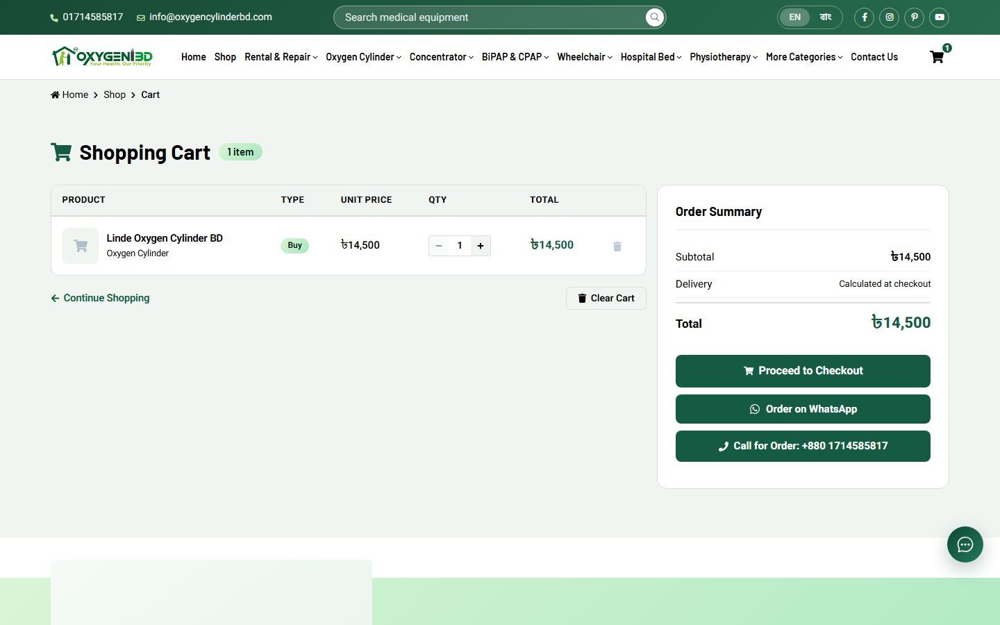
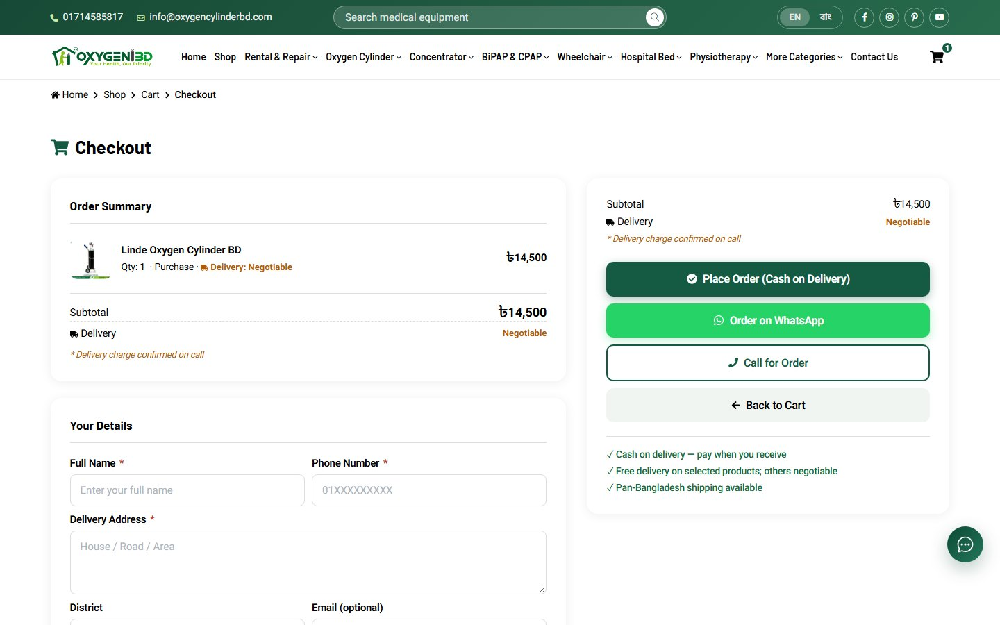
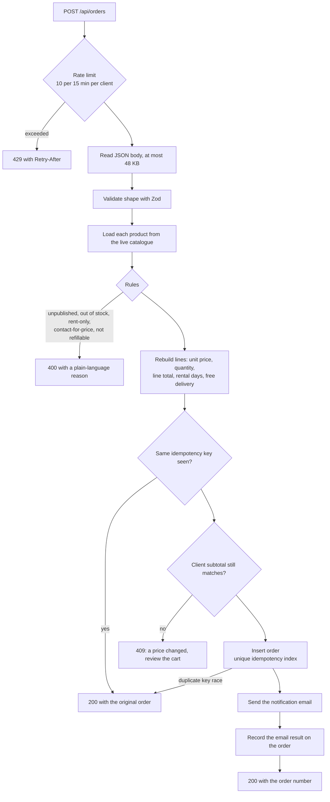
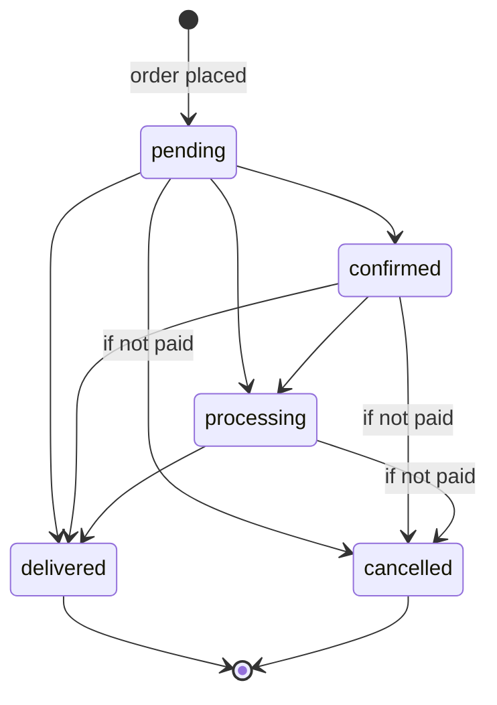
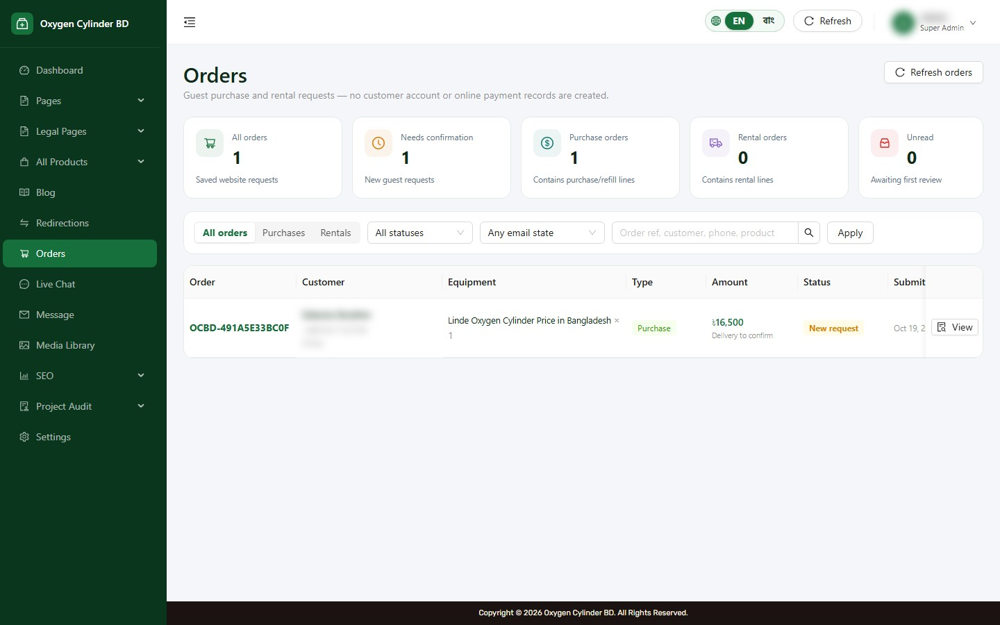

# Commerce and orders

> How a visitor goes from a product page to an order the team can act on, without an account or an online payment. [Back to the overview](../README.md)

## Contents

- [Scope](#scope)
- [Service options on a product](#service-options-on-a-product)
- [Cart](#cart)
- [Checkout](#checkout)
- [Order placement on the server](#order-placement-on-the-server)
- [Order lifecycle](#order-lifecycle)
- [Notifications](#notifications)
- [Admin order management](#admin-order-management)
- [Alternatives to the web checkout](#alternatives-to-the-web-checkout)
- [Design notes](#design-notes)

## Scope

| In scope | Deliberately out of scope |
| --- | --- |
| Guest cart and checkout | Customer accounts and sign-in |
| Purchase, rental and refill lines in one order | Online card or wallet payment |
| Cash on delivery; delivery fee quoted by the team when it isn't free | Automatic delivery-fee calculation |
| Order notification email; WhatsApp and phone ordering | SMS gateway |
| Admin order queue with a forward-only status lifecycle | Inventory reservation and stock decrement |

Customers in this market expect to confirm medical-equipment orders in conversation, often on WhatsApp, and to pay on delivery. The checkout records an accurate, structured request and leaves the confirmation to people.

## Service options on a product

| Option | Data | Storefront behaviour |
| --- | --- | --- |
| **Buy** | `price`, optional `regularPrice` (shown struck through), `contactForPrice` | Shows the price, or "contact for price" when it is negotiable |
| **Rent** | `rentable`, `rentTiers[]` of `{ days, price, label }` | The visitor picks a fixed package ("For 5 days ৳6,000", "For 10 days ৳8,000", "For 30 days ৳15,000") |
| **Refill** | `refillable`, `refillPriceMin`, `refillPriceMax` | Shows a refill price range |

A product can offer any combination. Products in the **Rental Services** category are rent-only, and that rule is applied in three places: the product page, the cart, and the order server.

<table>
  <tr>
    <td width="50%"> One product, three service options</td>
    <td width="50%"> Fixed rental packages</td>
  </tr>
</table>

## Cart

The cart is client-side state: a React context persisted to `localStorage` under a versioned key. It needs no server session, so the cart survives reloads and works for guests.

| Rule | Implementation |
| --- | --- |
| One line per product and option | The line key combines product, type and rental package, so the same product can be bought and rented in one order |
| Rentals need a package | A rental line without a package (from an older saved cart) is flagged and must be re-selected before checkout |
| Category rules can change | Lines saved before a product became rent-only are flagged instead of being submitted as purchases |
| Prices are for display only | The cart shows prices, but the server recalculates every line at checkout |

The cart opens as a **drawer** from any page and as a full **cart page** with an order summary. Both offer the checkout, a WhatsApp order and a phone call.

<table>
  <tr>
    <td width="50%"> Cart drawer</td>
    <td width="50%"> Cart page</td>
  </tr>
</table>

## Checkout

The checkout asks for a name, phone number, delivery address, district, an optional email and the preferred contact method (phone, WhatsApp or email). It shows:

- each line with its type (purchase, rental with package, or refill),
- whether delivery is free or "negotiable, confirmed on call" for each line,
- the subtotal, with the total confirmed by the team,
- three ways to finish: **Place Order (Cash on Delivery)**, **Order on WhatsApp**, **Call for Order**.

## Order placement on the server

The browser sends product references, quantities, chosen options, the rental package, contact details, an **idempotency key** and the subtotal it displayed. Everything else comes from the database.

| Check | Effect |
| --- | --- |
| Unknown or invalid product id | "One or more products are invalid. Refresh the cart and try again." |
| Product unpublished since it was added | "A product in your cart is no longer available." |
| Out of stock | Named in the message, so the visitor knows which line to remove |
| Rent-only product bought | "Available for rent only. Select a rental package to continue." |
| Refill for a product that doesn't offer it | Refused |
| Contact-for-price product | The visitor is asked to contact the team; no order is created at price 0 |
| Same product and option twice | Refused, because quantities belong on one line |
| Email chosen as the contact method but missing | Refused with guidance |
| Displayed subtotal is stale | 409 with the current subtotal, so the customer confirms the new amount |

The idempotency key makes retries safe. A double-click, a flaky connection or a resubmitted form returns the **original** order and sends no second email. If two identical submissions race, the unique index lets only one of them be stored.

## Order lifecycle

- Status can only move **forward** through pending → confirmed → processing → delivered. It may skip a stage, but never goes back.
- `delivered` and `cancelled` are final.
- An order marked **paid** can't be cancelled.
- Payment is recorded separately (`due` or `paid`), and the method is always cash on delivery.
- A rental order records its package days, start and end dates, and the date the equipment was returned.
- When any line isn't free to deliver, the order shows that a **delivery quote** is needed until staff enter a fee.

These rules live in one module (`orderRules`), which the admin API and the admin UI both use.

## Notifications

An accepted order is never discarded because email is unavailable. The handler stores the order first, then tries to notify the team. The result is written to the order:

| Field | Meaning |
| --- | --- |
| `status` | `pending`, `sent`, `skipped` (mail not configured) or `failed` |
| `attempts` | How many sends have been tried |
| `messageId`, `sentAt` | Proof of delivery to the mail server |
| `lastError` | The reason for the last failure, shown to staff |

Staff can filter orders by email state and retry a failed notification from the admin panel. Mail is sent through Nodemailer, either with a Gmail app password or a transactional SMTP account.

## Admin order management

| Feature | Detail |
| --- | --- |
| Counters | All orders, needs confirmation, purchase orders, rental orders, unread |
| Views | All, Purchases and Rentals tabs; status and email-state filters; search by order reference, customer, phone or product |
| Order detail | Lines with type and rental terms, customer and preferred contact, delivery quote, admin notes, payment state |
| Workflow | Forward-only status changes, mark paid, enter a delivery fee, record a rental return, retry the email |
| Unread tracking | New orders stay highlighted until a staff member opens them; the dashboard shows the count |

## Alternatives to the web checkout

| Channel | How it works |
| --- | --- |
| WhatsApp | A prefilled message lists every item, option, rental package and quantity, so the team sees the same detail as a web order |
| Phone | Click-to-call on every product, in the cart, at checkout and in the mobile contact bar |
| Live chat | A visitor can ask before ordering; staff answer from the admin panel |

## Design notes

- **No price ever comes from the browser.** The displayed subtotal is only used to detect that a price changed while the cart was open.
- **Order lines are snapshots.** Every line field is immutable after creation, so an order still shows what the customer agreed to after the catalogue changes.
- **One rule set.** Rental packages, rent-only categories and status transitions are each defined once and shared by the storefront, the order server and the admin panel.
- **Failure is visible.** Every failure a customer can hit returns a message that tells them what to do next, and every notification failure is visible to staff.
