# Content management

> The admin panel the content and operations team uses every day: how it is organized, how editing works, and the safeguards behind each save. [Back to the overview](../README.md)

## Contents

- [The admin shell](#the-admin-shell)
- [Roles and permissions](#roles-and-permissions)
- [Catalogue editing](#catalogue-editing)
- [Page studios](#page-studios)
- [The document editor](#the-document-editor)
- [Media library and image details](#media-library-and-image-details)
- [Drafts, review and publishing](#drafts-review-and-publishing)
- [SEO Review in every editor](#seo-review-in-every-editor)
- [Errors that explain themselves](#errors-that-explain-themselves)
- [Editing safeguards](#editing-safeguards)

## The admin shell

The admin panel is built with Ant Design 6. It has a collapsible, role-filtered sidebar, its own English/Bengali language switch, and a profile menu that shows the signed-in role.

| Section | Screens |
| --- | --- |
| Dashboard | Operations overview, action queue, catalogue and media counts, visitor summary |
| Pages | Home, About, All Blogs page, Contact Us, Career, FAQ, Footer |
| Legal Pages | Overview plus Privacy Policy, Terms & Conditions, Warranty, Delivery, Return & Refund, How to Buy, Affiliate Program |
| All Products | Products, Categories (including the locked All Products default category) |
| Blog | Post list and post editor |
| Redirections | URL management |
| Orders · Live Chat · Message | Guest orders, visitor chat, the team inbox |
| Media Library | Every uploaded file |
| SEO | Overview, SEO Parameters, Page Inventory, Content Audit, Search Performance, Google Analytics, Visitor Analytics, Core Web Vitals, Publication Results, Structured Data, SEO Operations |
| Project Audit | Overview, Security, Reliability, Performance, Architecture, Integrations, Roadmap |
| Settings | Brand identity, contact details, logos and favicon, search appearance |

<table>
  <tr>
    <td width="50%">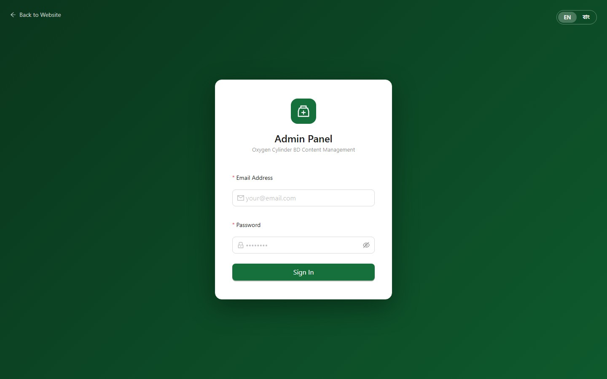 Sign-in (rate-limited, scrypt-hashed accounts)</td>
    <td width="50%">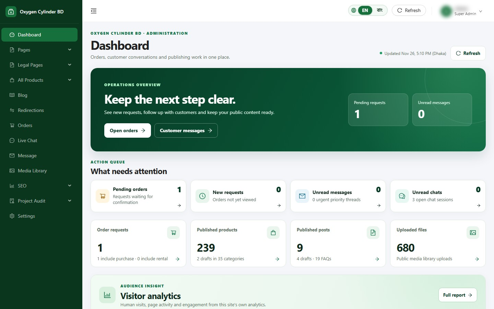 Dashboard: what needs attention first</td>
  </tr>
</table>

## Roles and permissions

| Role | Can open | Can't |
| --- | --- | --- |
| **Super Admin** | Everything | — |
| **Admin** | Everything except three Media Library actions | Upload through the Media Library page, delete files, or run media cleanup |
| **Content Admin** | Page content, legal pages, products, categories, blog, FAQ and their SEO fields; uploading images and editing image details from those editors | Delete, unpublish or hide live content; open the dashboard, orders, chat, inbox, media library, redirections, SEO workspace, project audit or settings |

The same role table drives three things: the proxy page gate, the API guard and the sidebar. They can't drift apart. API routes are closed to Content Admins unless a handler explicitly opts in with `withContentAdmin`, so a new endpoint is safe by default. A Content Admin who opens a screen outside their permissions is sent to their own start page, the Home page editor.

## Catalogue editing

### Products

<table>
  <tr>
    <td width="50%">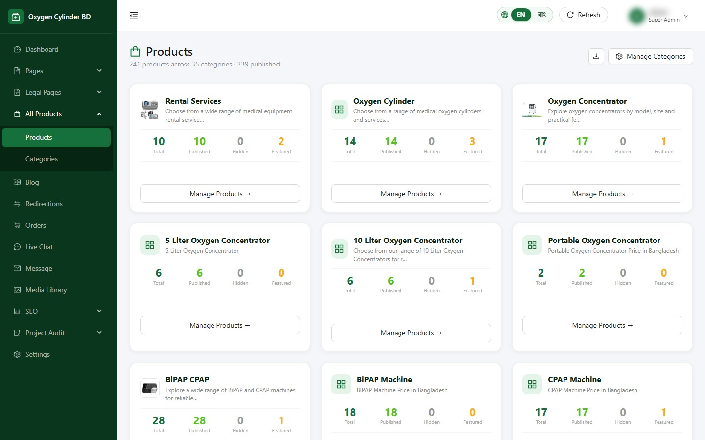 Products grouped by category: total, published, hidden, featured</td>
    <td width="50%">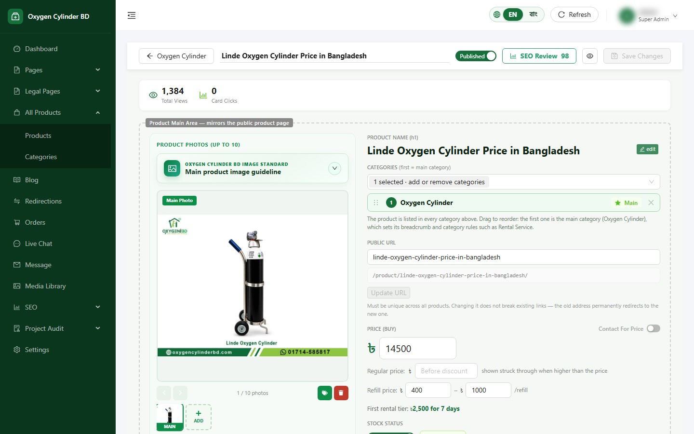 The editor mirrors the public product page</td>
  </tr>
</table>

- **Mirrors the public page.** The editor's main area follows the layout of the live product page, so staff edit what customers see.
- **Several categories.** A product can be listed in several categories. The first is the main category, which sets the breadcrumb and category rules such as "rent only". Each category keeps its own order, and drag-and-drop reordering changes only that category's order.
- **Public URL changes are safe.** Changing a product URL keeps the old address and redirects it permanently.
- **Pricing for every service.** Purchase price, regular price before discount, contact-for-price, refill price range and rental packages are all edited on one screen.
- **Specifications from anywhere.** Specification rows can be pasted from Excel, Google Sheets, WordPress tables, Markdown or a document, and are converted into structured rows.
- **Gallery.** Up to ten photos, with an image guideline for the main photo, a featured slider image and SEO details for every image.
- **Reuse.** Staff can duplicate a product, or import the description from another product as a starting point.
- **Signals.** Total views and card clicks are shown at the top of the editor.

### Categories and the shop page

<table>
  <tr>
    <td width="50%">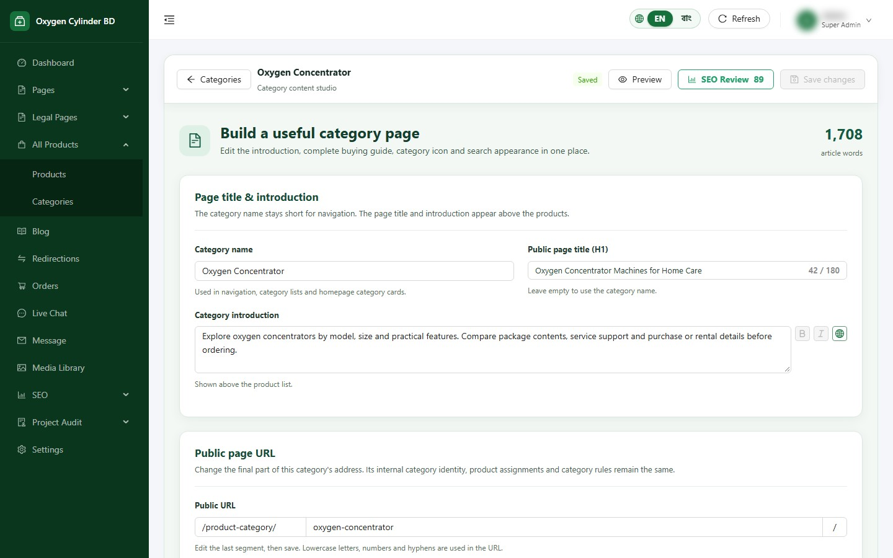 Category studio: H1, introduction, public URL, buying guide, icon, SEO</td>
    <td width="50%">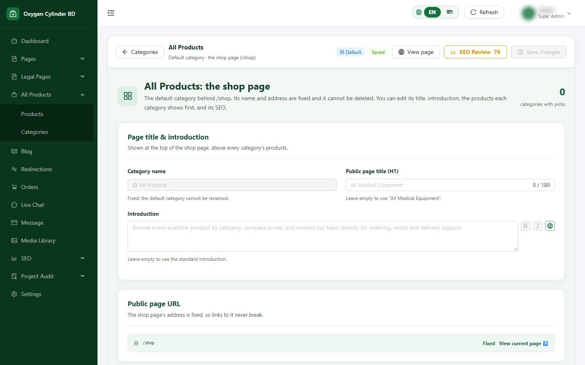 The locked All Products category behind <code>/shop</code></td>
  </tr>
</table>

- Every category page has a short name for menus and a longer public title (H1), an introduction, a full **buying guide** written in the document editor, an icon and SEO fields.
- Before a category's **public URL** changes, the studio checks where the old URL is used. Old links keep working through the category's URL history.
- The **All Products** default category renders `/shop`. Its name and URL are locked and it can't be deleted. Staff can edit the title, the introduction, the SEO, and up to eight products shown first in each category.

## Page studios

The Home, About, Contact, Career, blog index, FAQ and Footer pages each have a studio. A studio edits the page section by section, in the order the sections appear on the live page.

<table>
  <tr>
    <td width="50%">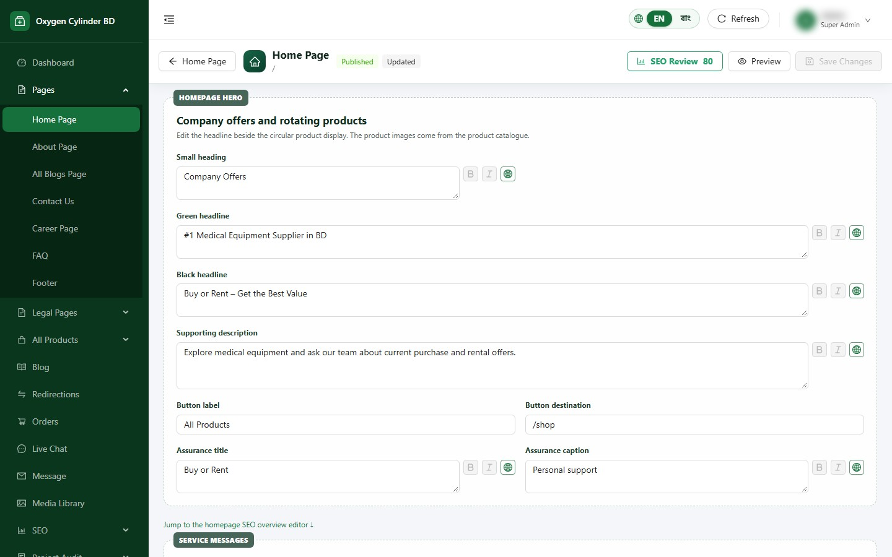 Home page studio</td>
    <td width="50%">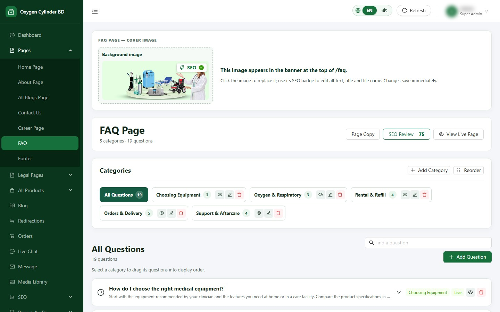 FAQ: categories, questions, drag ordering, live or hidden</td>
  </tr>
  <tr>
    <td>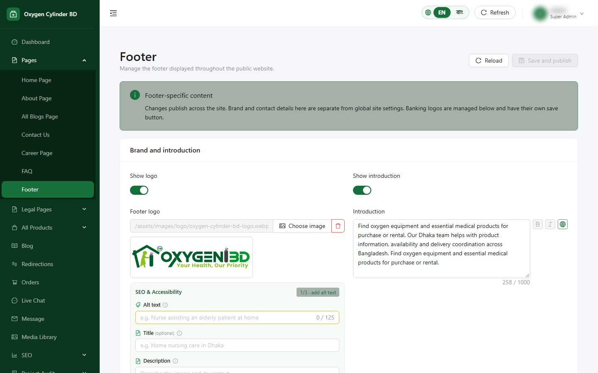 Footer: logo, introduction, payment logos</td>
    <td>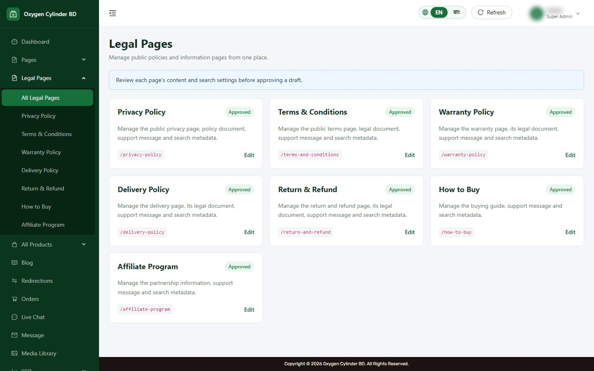 Seven legal and information pages with approval states</td>
  </tr>
</table>

- **Inline formatting without HTML.** Short fields support bold, italic and links. They are stored as plain text with character ranges for links and emphasis, so the stored text never contains markup and links are validated before saving.
- **Sections editors don't need to code.** These include the Shop by Category cards, the "why choose us" video, the home SEO overview with its show-more control, payment logos, the career openings and the FAQ cover image.
- **Site-wide settings** (brand, contacts, logos, favicon, search appearance) are a separate, full-admin screen.

## The document editor

Long-form content (product descriptions, category buying guides, blog posts and legal pages) is written in a Word-style editor built on **Tiptap 3 / ProseMirror**.

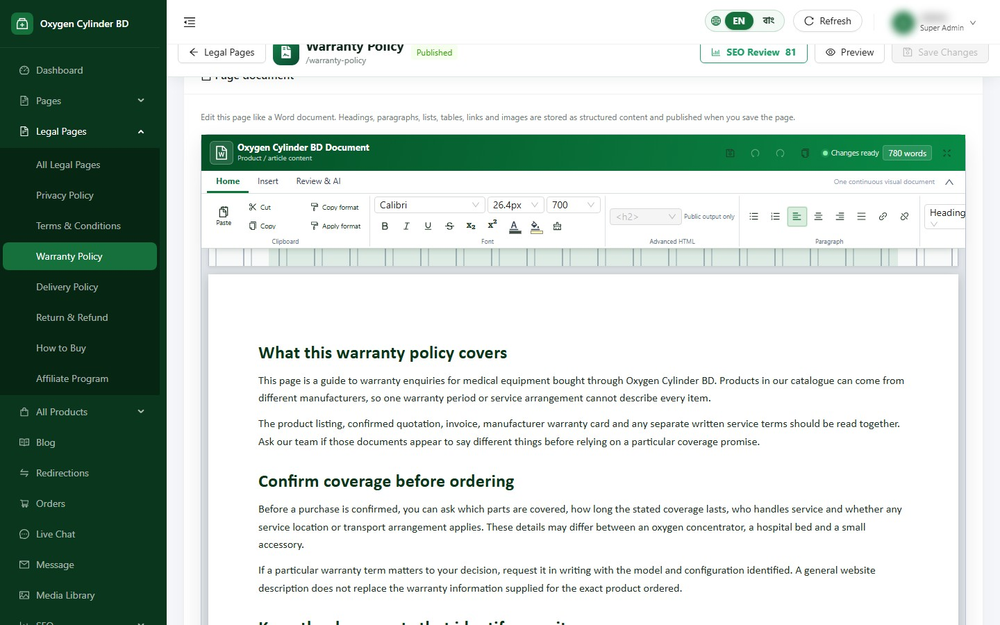

| Area | Capabilities |
| --- | --- |
| Ribbon: Home | Clipboard, copy and apply formatting, font family, size and weight, bold, italic, underline, strike, subscript, superscript, text colour, highlight, clear formatting, lists, alignment, links, heading levels |
| Ribbon: Insert | Paper size, divider, current date, links, pictures with alt text, YouTube video, editable charts and shapes, tables with row and column actions, symbols, emoji, special spaces, print |
| Ribbon: review tools | Find and replace, word and character counts, browser proofing toggle, keyboard shortcuts, zoom |
| Structure control | "Advanced HTML" lets an editor choose the element a block is published as (for example `h2` or `p`) without writing HTML |
| Working state | Save draft, the live version indicator, unsaved changes, full-screen mode, word count |
| Paste | Content pasted from Word, Google Docs or another CMS becomes editable blocks |

### What is stored

The editor doesn't store HTML. A document is an **ordered list of typed blocks**: `heading`, `paragraph`, `bullets`, `table`, `image`, `video`, `visual` (charts and shapes) and `divider`. Text inside blocks uses the same safe inline format as the studios.

| Decision | Why |
| --- | --- |
| Blocks instead of a fixed template | The page can follow the content: two headings in a row, a list before any prose, or a table in the middle |
| Structured data instead of HTML | Links stay validated, text stays searchable and scoreable, and nothing an editor pastes can inject markup |
| A closed set of presentation choices | Editors can't break the theme's typography or hide text with free-form CSS |
| An allowlist parser for pasted content | Only known elements are kept; scripts, styles and attributes are dropped before the content is read |
| Unknown blocks degrade to paragraphs | A document saved by a newer editor still shows its text on an older deployment |
| Legacy shapes converted on demand | Records from older content shapes open in the editor intact; nothing is rewritten until someone saves |
| The same limits in the editor and the API | The editor checks a document before saving and the server checks it again |

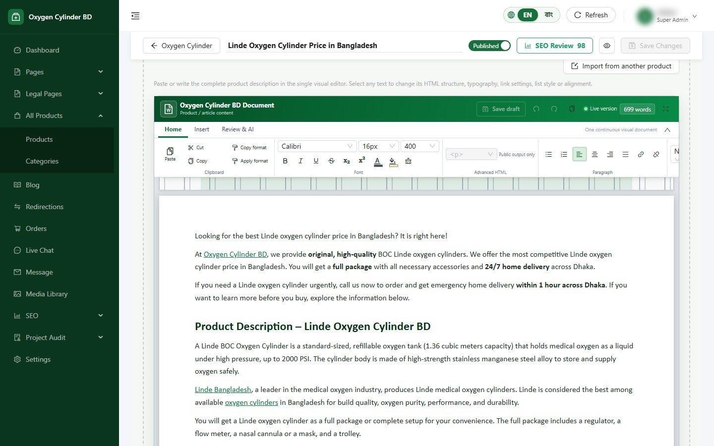

## Media library and image details

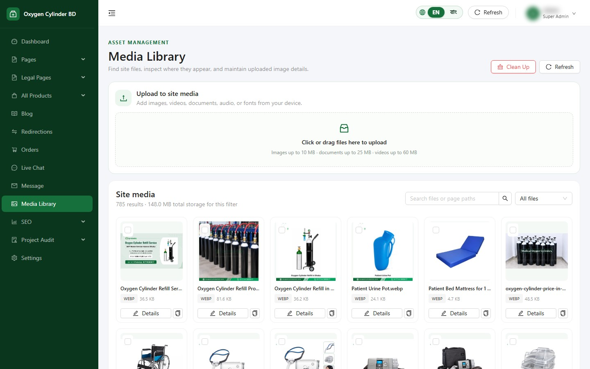

| Capability | Detail |
| --- | --- |
| Upload | Images up to 10 MB, documents up to 25 MB, videos up to 60 MB |
| Find | Search by file name or by the page path where a file is used; filter by type |
| Inspect | Each file shows where it appears across products, categories, posts and pages |
| Image details | Alt text, title, description and SEO file name (the extension is locked so a WebP can't be renamed `.jpg`) |
| Clean up | Files no content refers to can be removed; any uncertainty keeps the file |
| Delivery | Streamed from GridFS by id or by SEO file name, with one-year immutable caching |

### One image, one set of details

An image's alt text, title and description belong to the **media record**, not to each page that uses it.

1. Any image field in any editor loads the current details from the media record.
2. Typed changes are autosaved with a revision check. On a conflict, the editor re-reads the record and retries once.
3. Other open editors and browser tabs are notified through `BroadcastChannel`.
4. On the server, the change is copied into every page that uses the image, and every save route reconciles media details before writing. A stale form can't put old alt text back.

The result: the same image shows the same alt text on every page and in every JSON-LD block.

## Drafts, review and publishing

| Mechanism | Where | Effect |
| --- | --- | --- |
| Body drafts | Products and blog posts | "Save draft" stores the document separately from the live body; the live page doesn't change until the draft is published |
| Working and published copies | Managed pages | Page content keeps a working copy and the published copy apart |
| Editorial review | Products, categories, posts, managed pages | `draft`, `in_review`, `changes_requested`, `approved`, with reviewer and date |
| Medical review | The same records | `not_required` through `approved`, for copy that touches on patient care |
| Publish switch | Every public record | Content Admins can publish but not unpublish; full admins can take content offline |

Review state is not just a label: a record that isn't review-ready is left out of the sitemap (see [SEO and structured data](SEO_AND_STRUCTURED_DATA.md)).

## SEO Review in every editor

Products, categories, blog posts, the shop page, managed pages, legal pages and the FAQ each have an **SEO Review** button showing the live score.

<table>
  <tr>
    <td width="50%">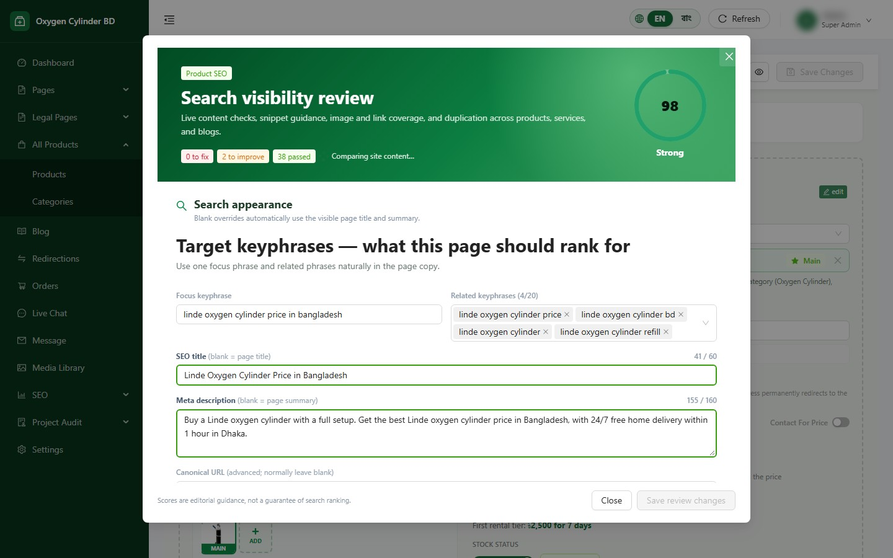 Score, checks, keyphrases and snippet fields</td>
    <td width="50%">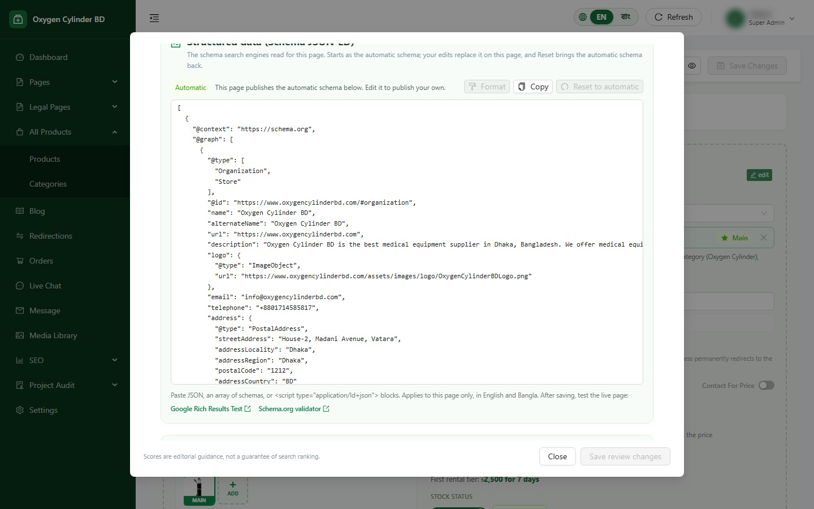 Custom structured data, starting from the automatic schema</td>
  </tr>
</table>

- The score is split into findings to fix, findings to improve, and checks passed.
- A focus keyphrase plus up to 20 related keyphrases.
- An SEO title (60 characters) and meta description (160) with live counters, and a fallback to the visible title and summary when left blank.
- Advanced fields: canonical URL, `noindex` and `nofollow`, Open Graph values.
- Duplicate checks against titles and descriptions across the whole site.
- A **Structured data (Schema JSON-LD)** field. It starts with the page's automatic schema. A saved custom schema replaces the automatic one on that page only, and **Reset to automatic** brings it back.

Scores are editorial guidance. The panel says so, and doesn't promise rankings.

## Errors that explain themselves

Admin errors and warnings open a **problem modal** instead of a brief toast. A rules module (`adminProblemGuide`) maps each failure to:

- what went wrong, in plain language,
- the field or setting involved,
- what to do next,
- technical details for support, including the last failed API status and the server's reply.

Success, info and loading messages stay as small toasts. The rules have their own test suite, and new error messages need a matching rule.

## Editing safeguards

| Safeguard | Effect |
| --- | --- |
| Revision and timestamp checks | Two people editing the same record can't silently overwrite each other; the later save is told to reload |
| Validation on both sides | Zod schemas on the server, the same limits in the editors |
| Slug and URL history | Renaming never breaks a link |
| Deny-by-default APIs | A newly added endpoint is closed to Content Admins until a handler opts in |
| Incremental loading | Long admin lists load in batches, so large catalogues stay responsive |
| Media ownership registry | Every collection that can hold images is registered, so cleanup never deletes a file that is still in use |
