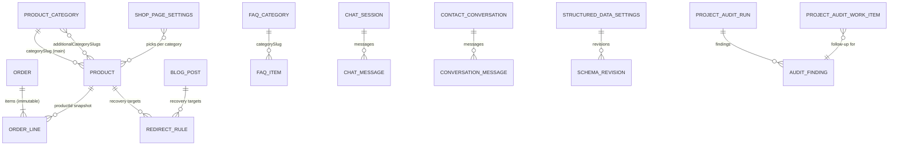

# Data model

> The MongoDB collections behind the application, the shapes they share, and the rules that keep them consistent. [Back to the overview](../README.md)

Production runs on MongoDB 8 on the application server. Development uses MongoDB Atlas. The private application defines **21 Mongoose models**, plus a GridFS bucket and two collections that are accessed with the native driver. Field names below are real; validation details, index options and data are not published.

## Contents

- [Overview](#overview)
- [Catalogue](#catalogue)
- [Orders](#orders)
- [Content](#content)
- [Conversations](#conversations)
- [Discoverability and redirects](#discoverability-and-redirects)
- [Operations and localization](#operations-and-localization)
- [Media and analytics collections](#media-and-analytics-collections)
- [Shared sub-schemas](#shared-sub-schemas)
- [Data rules](#data-rules)

## Overview

| Domain | Models | Collection naming |
| --- | --- | --- |
| Catalogue | `ProductCategory`, `Product`, `ShopPageSettings` | Mongoose defaults; `oxygen_shop_page_settings` |
| Ordering | `Order` | Mongoose default |
| Content | `PageContent`, `BlogPost`, `FaqCategory`, `FaqItem`, `PageSharing`, `SiteSettings` | Mongoose defaults; `oxygen_site_settings` |
| Conversations | `ChatSession`, `ContactConversation` | Mongoose defaults |
| Discoverability | `SeoAdminSettings`, `SeoPageSpeedAudit`, `StructuredDataSettings`, `Redirection`, `RedirectRule` | `oxygen_`-prefixed for settings and audits |
| Operations | `ProjectAuditRun`, `ProjectAuditWorkItem`, `SeedTombstone` | `oxygen_project_audit_*` |
| Localization | `TranslationCache` | Mongoose default, TTL-indexed |

Settings and audit collections use an `oxygen_` prefix. This keeps them easy to identify in a shared development cluster.

## Catalogue

### `ProductCategory`

| Field group | Fields | Notes |
| --- | --- | --- |
| Identity | `name`, `pageTitle`, `slug` | `slug` is the stable internal identity; `pageTitle` is the public H1 |
| Public URL | `publicSlug`, `previousPublicSlugs`, `previousSlugs`, `urlReferencesPending` | The public URL can change without changing the identity; previous values keep old links working |
| Content | `description`, `contentBlocks`, `showTableOfContents`, `icon` | The buying guide is a block document; the table of contents is on by default for categories |
| Presentation | `order`, `published` | `order` drives menus, the shop page and category cards |
| SEO and review | `seo`, `review` | Shared sub-schemas (below) |
| Provenance | `wordpressTermId`, `sourceUrl`, `sourcePath`, `contentHtml`, `wordpress`, `media` | Kept from the WooCommerce import for traceability; not used for rendering |

### `Product`

| Field group | Fields | Notes |
| --- | --- | --- |
| Identity and URL | `name`, `slug`, `previousSlugs`, `redirectTo`, `sku` | `slug` is unique; renames push the old value onto `previousSlugs` |
| Placement | `categorySlug`, `additionalCategorySlugs`, `additionalCategoryOrders`, `order`, `featured` | One main category sets the breadcrumb and category rules; extra categories each keep their own position |
| Purchase pricing | `price`, `regularPrice`, `contactForPrice` | `regularPrice` is shown struck through when it is higher than `price` |
| Rental | `rentable`, `rentalPrice`, `rentTiers[]` (`days`, `price`, `label`) | Fixed packages such as 5, 10 or 30 days |
| Refill | `refillable`, `refillPriceMin`, `refillPriceMax` | A refill price range rather than one number |
| Merchandising | `badge`, `badgeTextColor`, `badgeBackgroundColor`, `inStock`, `freeDelivery` | Badge colours are validated `#RRGGBB` values |
| Media | `image`, `images[]`, `featuredSliderImage` | Structured image values (up to 10 gallery images) |
| Copy | `shortDesc`, `summaryBullets`, `specs`, `specTables[]`, `contentBlocks`, `showTableOfContents`, `contentDraft` | Product contents tables are opt-in; `contentDraft` is not selected by default |
| Legacy shapes | `description`, `descriptionSections` | Older fixed shapes, converted to blocks on demand and never rewritten in place |
| Signals | `views`, `clicks` | Shown in the editor |
| SEO and review | `seo`, `review` | Shared sub-schemas |
| Provenance | `wordpressProductId`, `wordpressStatus`, `wordpressType`, `sourceUrl`, `sourcePath`, `contentHtml`, `shortDescriptionHtml`, `wordpress`, `media` | From the WooCommerce import |

**Indexes** cover the storefront's hot paths: published and category; published, category, order and creation date; slug and previous slugs; additional categories; and a text index on name and short description.

### `ShopPageSettings`

The `/shop` page is a protected **default category** called "All Products". It is stored as one keyed record in its own collection, not in `productcategories`, so it can never appear in category pickers, menus, the sitemap or `/product-category/` URLs. Its name and path are defined in code and never stored. Staff can edit:

- `pageTitle` and `description`,
- `picks`: up to 8 products per category to show first (`categorySlug`, `productIds`),
- `seo` and `review`.

The record is created on the first save. Until then, `/shop` renders the default copy.

## Orders

### `Order`

| Field group | Fields | Notes |
| --- | --- | --- |
| Identity | `orderNumber`, `idempotencyKey` | `idempotencyKey` has a unique sparse index, so a double submission can't create a second order |
| Lines | `items[]`: `productId`, `productSlug`, `categorySlug`, `sku`, `name`, `image`, `unitPrice`, `quantity` (1–99), `lineTotal`, `type` (`buy`, `rent`, `refill`), `freeDelivery`, `rental` (`billing`, `days`, `label`) | Every line field is **immutable** once the order exists |
| Kinds | `orderKinds` (`purchase`, `rent`) | Indexed for the admin's Purchases and Rentals tabs |
| Customer | `customer`: `name`, `phone`, `email`, `address`, `district`, `preferredContact` (`phone`, `whatsapp`, `email`) | Length-limited; email lower-cased |
| Money | `subtotal`, `deliveryFee`, `totalAmount`, `paymentMethod` (`cash-on-delivery`), `paymentStatus` (`due`, `paid`) | `deliveryFee` stays empty until a non-free delivery is quoted |
| Rental | `rental`: `days`, `startDate`, `endDate`, `returnedAt` | Rental terms and the return record |
| Workflow | `status` (`pending`, `confirmed`, `processing`, `delivered`, `cancelled`), `source` (`website`, `whatsapp`, `phone`), `notes`, `adminNotes`, `viewedByAdmin` | `viewedByAdmin` drives the "new" badge |
| Notification | `emailNotification`: `status` (`pending`, `sent`, `skipped`, `failed`), `attempts`, `messageId`, `sentAt`, `lastError` | An order is never lost because mail failed; staff can retry |

**Indexes:** newest first, by status, by kind, by line type and by unread state, all sorted by creation date.

## Content

| Model | Key fields | Notes |
| --- | --- | --- |
| `PageContent` | `page`, `content`, `publishedContent`, `updatedBy` | Managed pages such as home, about, contact, career, the blog index and the legal pages. The working `content` and the live `publishedContent` are stored separately |
| `BlogPost` | `title`, `slug`, `previousSlugs`, `excerpt`, `contentBlocks`, `showTableOfContents`, `contentDraft`, `keyTakeaways`, `images`, `thumbnail`, `author`, `date`, `category`, `tags`, `published`, `seo`, `review` | Imported WordPress posts keep `wordpressPostId` and their historic path |
| `FaqCategory` / `FaqItem` | `name`, `slug`, `order`, `published` / `question`, `answer`, `categorySlug`, `order`, `published` | `seedKey` makes seeding idempotent |
| `PageSharing` | `page`, `featuredImage`, `ogImage`, `ogTitle`, `ogDescription`, `revision` | Social sharing values for fixed pages |
| `SiteSettings` | `brand`, `contact`, `socialLinks`, `seo`, `footer`, `revision` | Site-wide identity and contact details; `revision` prevents lost updates |

## Conversations

| Model | Key fields | Notes |
| --- | --- | --- |
| `ChatSession` | `sessionKey`, `status`, `participant`, `messages[]` (`sender`, `text`, `createdAt`), `unreadForAdmin`, `lastMessageAt`, `closedBy`, `closedAt` | Anonymous visitor chat; either side can end it |
| `ContactConversation` | `reference`, `idempotencyKey`, `contact`, `subject`, `inquiryType`, `productName`, `source`, `consentAt`, `priority`, `status`, `assignedAdmin`, `messages[]` (`senderType`, `body`, `emailStatus`, `emailError`, `emailSentAt`, `readByAdminAt`), `messageCount` | A team inbox thread. Replies are emailed and the delivery result is stored on each message. The time of the visitor's consent is recorded |

## Discoverability and redirects

| Model | Key fields | Notes |
| --- | --- | --- |
| `Redirection` | `sourcePath`, `sourceKey`, `sourceQuery`, `queryMode`, `destinationPath`, `destinationKey`, `statusCode`, `enabled`, `note`, `hits`, `lastAccessAt`, `createdBy`, `updatedBy` | Staff-managed rules. `sourceKey` is a normalized, indexed lookup key (case and trailing slash ignored) |
| `RedirectRule` | `entity`, `slug`, `categorySlug`, `title`, `targets` | Recovery targets kept after a product or post is deleted |
| `StructuredDataSettings` | `key`, `version`, `draft`, `published`, `publishedAt`, `publishedBy`, `revisions[]` | Site-wide Organization/Store and WebSite schema; draft first, publish explicitly, restore any revision |
| `SeoAdminSettings` | `searchConsole`, `merchantCenter`, `analytics`, with `accessTokenCiphertext`, `refreshTokenCiphertext`, `tokenExpiresAt` | Google connection state. Tokens and keys are stored encrypted |
| `SeoPageSpeedAudit` | `url`, `strategy`, `performanceScore`, `seoScore`, `accessibilityScore`, `bestPracticesScore`, `lcp`, `cls`, `inp`, `fcp`, `ttfb`, `tbt`, `opportunities`, `checkedAt` | History of PageSpeed checks run from the admin panel |

## Operations and localization

| Model | Key fields | Notes |
| --- | --- | --- |
| `ProjectAuditRun` | `runId`, `ranAt`, `ranBy`, `score`, `summary`, `findings`, `metrics` | A saved snapshot of the read-only project audit |
| `ProjectAuditWorkItem` | `itemId`, `status`, `owner`, `note`, `updatedBy` | Follow-up tracking, stored apart from the audit itself |
| `SeedTombstone` | `model`, `key` | Records deliberate deletions so re-running an import or seed script can't bring a record back |
| `TranslationCache` | `key`, `text`, `expiresAt` | Cached translations; a TTL index (`expireAfterSeconds: 0`) removes them when they expire |

## Media and analytics collections

| Collection | Access | Contents |
| --- | --- | --- |
| `uploads.files` / `uploads.chunks` | GridFS | Uploaded images, video and documents, with metadata: content type, SEO file name, alt text, title, description |
| `public_asset_metadata` | Native driver | Alt text, title and description for images bundled with the application |
| `visitor_pageviews` | Native driver | One document per page view: daily-salted visitor hash, path, referrer host, country, network, device, bot and data-center flags, duration. Never an IP address. TTL index removes documents after 400 days |

## Shared sub-schemas

Several models embed the same sub-schemas, so every editor, every audit and every public page reads the same shape.

| Sub-schema | Fields | Used by |
| --- | --- | --- |
| SEO | `focusKeyword`, `keywords`, `metaTitle`, `metaDescription`, `canonicalUrl`, `noindex`, `nofollow`, `ogTitle`, `ogDescription`, `featuredImage`, `ogImage`, `schemaJsonLd` | Products, categories, blog posts, the shop page, managed pages |
| Editorial review | `editorialStatus` (`draft`, `in_review`, `changes_requested`, `approved`), `editorialReviewer`, `editorialReviewedAt`, `medicalStatus` (`not_required`, `pending`, `in_review`, `changes_requested`, `approved`), `medicalReviewer`, `medicalReviewedAt`, `notes` | The same records. Medical review exists because product and guide copy can touch on patient care |
| Content draft | `blocks`, `savedAt`, `savedBy` | Products and blog posts: a saved draft of the body that the live page doesn't show |

## Data rules

| Rule | How it is enforced |
| --- | --- |
| A price comes from the catalogue, never the browser | The order handler rebuilds each line from published products |
| Order history doesn't change | Line items are immutable; status moves only forward; a paid order can't be cancelled |
| Old URLs keep working | `previousSlugs`, `previousPublicSlugs` and `Redirection` records; the public URL builder is the only place URLs are made |
| Deleted means deleted | `SeedTombstone` stops imports and seeds from re-creating removed records |
| No lost updates | `revision` and `updatedAt` checks on settings, sharing values, image details and the shop page; a stale save receives HTTP 409 |
| Media is never orphaned or wrongly deleted | Every collection that can hold images is registered as a media owner; cleanup keeps any file whose usage it can't prove |
| Personal data stays minimal | Orders keep only what delivery needs; analytics never stores IP addresses; private records are never sent to the translation provider |
| Indexes stay predictable | Index names are left to Mongoose and driver defaults, which keeps automatic index creation and bootstrap scripts compatible |
