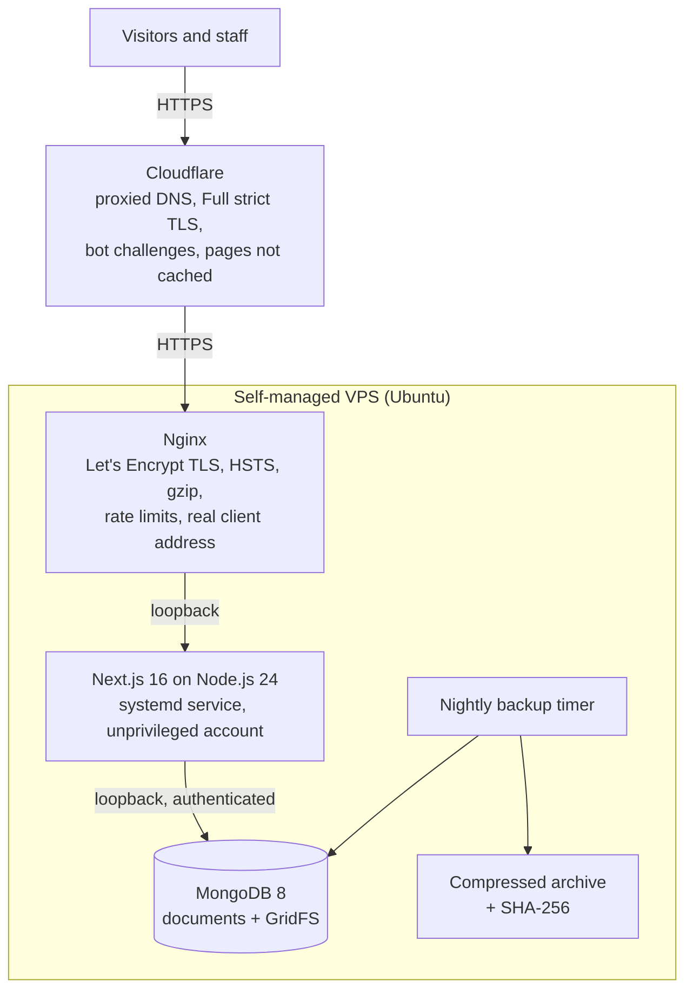
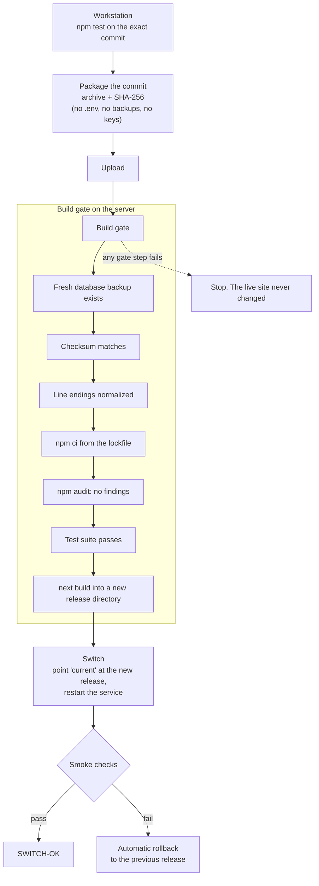

# Deployment and operations

> How the application is hosted, how a change reaches production, and how the team proves a release did what it should and nothing else. [Back to the overview](../README.md)

Server addresses, account names, file paths, unit files and scripts are private. This document describes the design and the evidence.

## Contents

- [Topology](#topology)
- [Environments](#environments)
- [The release pipeline](#the-release-pipeline)
- [Verification after a switch](#verification-after-a-switch)
- [Database changes](#database-changes)
- [Backups and recovery](#backups-and-recovery)
- [Observed operations](#observed-operations)
- [Runbook practices](#runbook-practices)
- [Next steps](#next-steps)

## Topology

| Layer | Responsibility |
| --- | --- |
| Cloudflare | DNS and proxy, TLS to the origin in Full (strict) mode, custom rules that challenge traffic from cloud-hosting networks. HTML passes through uncached. Rocket Loader and email obfuscation are off, because they rewrite HTML and break React hydration |
| Nginx | TLS termination with Let's Encrypt; HSTS; gzip; rate limiting; restoring the real client address from the edge and overwriting forwarded headers before they reach the application |
| Application | One systemd service under an unprivileged account, with a read-only home, writes limited to the application folder, and a private temp directory |
| Database | MongoDB 8 on the same host, bound to the host only, with authentication and a least-privilege application user |

## Environments

| Environment | Purpose | Data |
| --- | --- | --- |
| Development | Workstation builds and tests | A separate cloud MongoDB database, refreshed from production on request with a guarded, read-only export |
| Review | A public review address with `noindex` while the site was tested before the domain switch (26 Oct to 2 Nov 2026) | Migrated production data |
| Production | `www.oxygencylinderbd.com` | The live database, edited all day by the content team |

Production data is the source of truth. Code releases never overwrite content, and developers don't edit production data by hand.

## The release pipeline

| Property | Detail |
| --- | --- |
| Immutable releases | Each release is a separate directory named after its date, commit and purpose. The live site is a pointer to one of them |
| Atomic switch | Re-pointing the live release is a single step. The previous release stays on disk as a rollback target |
| Smoke checks | About 26 HTTP checks through the real web server: home, shop and shop search, a category and a product plus their old addresses (`308`), blog, FAQ, about, contact, cart and checkout, the admin sign-in page (`200`) and an admin API (`401` without a session), a media file and an optimized image, the sitemap and `robots.txt`, an unknown path (`404`), and the WordPress legacy layer (old checkout and post URLs, old sitemap and feed, `wp-login.php` answering `410 Gone`, and an old upload) |
| Automatic rollback | If a smoke check fails, the switch script restores the previous release on its own |
| Retention | The live release plus two rollback targets; older ones are pruned |
| Build safety | The tests run before the build, so a stale generated file (for example the translation catalogue) stops the release instead of shipping |

## Verification after a switch

The smoke checks prove the site is up. These checks prove it is **right**:

| Check | Method |
| --- | --- |
| Catalogue integrity | Every category page shows the number of products the database says it should, in the admin's order; every published product page renders; hidden products return 404 |
| Navigation | Every header menu link resolves on the live site |
| Structured data | JSON-LD from a fixed set of page types is dumped before and after the switch and compared |
| Unchanged pages | For releases that shouldn't change a page, its HTML is compared byte for byte with a baseline taken just before the switch |
| Access control | New admin endpoints return `401` without a session |
| Nothing else changed | The web server configuration is hashed before and after the switch; the service journal is checked for errors |
| Browser checks | Headless Chrome measures layouts on the live site, with the analytics beacon and the GA tag blocked so the measurements don't count as visits |

## Database changes

Schema and data changes never travel inside a code release.

1. **Migration scripts default to a dry run.** They print exactly what they would change; writing needs an explicit `--apply`.
2. **Inspect production before shipping data-dependent features.** Production data diverges from development, because the content team works in it all day.
3. **Additive first.** Migrations that only add run right after the switch, so admin saves made during the deploy can't be lost.
4. **Prove completion.** The dry run is repeated after applying and must report nothing left to do.
5. **No transactions on the standalone production database.** Scripts use per-document conditions and backup collections instead. In the application, `withOptionalTransaction()` uses a transaction only where the database supports one.
6. **Deletions are permanent.** Tombstones stop imports and seeds from re-creating anything the team deleted.

## Backups and recovery

- **Nightly** compressed logical backups of the database, including GridFS media, each with a SHA-256 checksum.
- **Before every release**, the build gate confirms that a fresh backup exists.
- **Before risky data work** (media cleanup, migrations), a scoped backup is taken with a restore procedure ready.
- **The original migration** from the development database was verified with a checksum, a dry-run restore, a full restore, and document and image counts.

| Situation | Recovery |
| --- | --- |
| A smoke check fails during a switch | Automatic: the previous release is restored |
| A problem is found later | Switch back to a retained release (the same atomic step) |
| A bad data migration | Restore the affected collection from the backup collection or the pre-change archive |
| Domain switch problems (in the first weeks) | Re-enable the previous web-server configuration with one reload |

## Observed operations

These are taken from the private deployment log. They show how the process behaved in practice.

- **22 November 2026: six production releases in one day.** These were the header menu plan, menu headings that link to categories, the desktop menu layout, the protected All Products category, the custom JSON-LD field, and a category-ordering fix. Each one passed the full gate (fresh backup, clean audit, tests, build) and switched cleanly, with a named rollback target. After the category-ordering fix, a dedicated check confirmed that all 35 category pages matched the admin order. Before the fix, 9 had been out of order.
- **The safety net has fired.** Twice in November, a smoke check rolled a release back automatically. Both times the content team had renamed a page used as a smoke-test sample. The checks were re-run against the previous release to prove the code wasn't at fault, the sample was updated, and the release was shipped again.
- **Security fixes as ordinary releases.** Framework and library advisories (Next.js, Nodemailer, Zod, Mongoose) were shipped through the same gate as any other change, never as an unreviewed hotfix.

## Runbook practices

The private runbook (a living document with a decision log) covers:

- phased plans with **gates**: a checklist that must pass before the next phase starts,
- **numbered owner decisions**, so nothing that belongs to the business is assumed,
- a rollback reference for each kind of failure,
- an operations handbook: status and logs, restarting only this site (about ten seconds), and how to change secrets (server-only values need a restart; public build-time values need a new release),
- **read-only first**: inspect production with read-only exports before changing anything that depends on its data.

## Next steps

| Item | Why |
| --- | --- |
| External uptime monitoring with alerting | The current checks run at release time; continuous monitoring would catch problems between releases |
| CI on every push | Tests run locally and in the release gate; running them on every push would catch failures earlier |
| Off-server backup copies with regular restore drills | Protect against losing the whole host, and prove restores still work |
| Release automation from a pinned commit | Keep the same gate, with less manual packaging |
