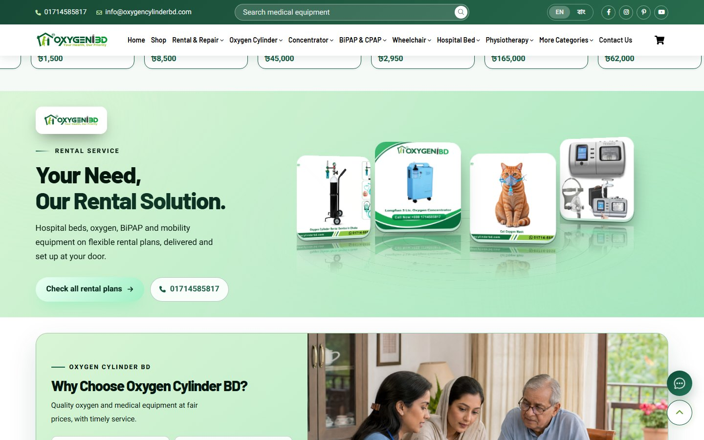
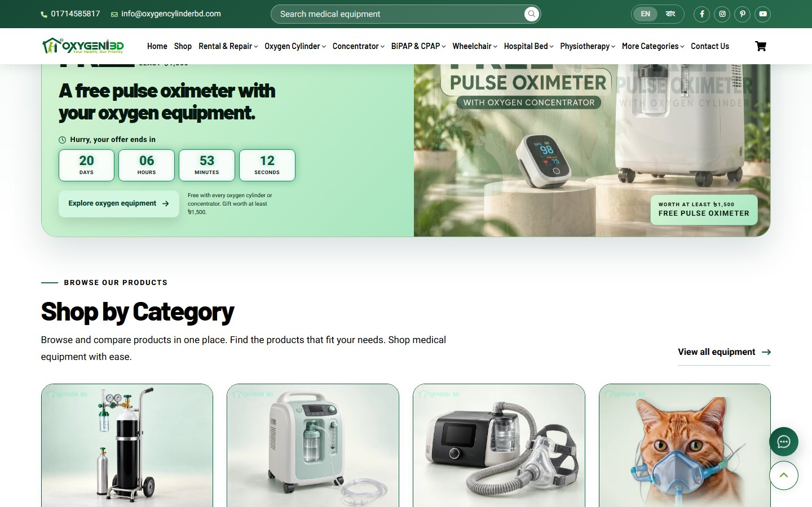
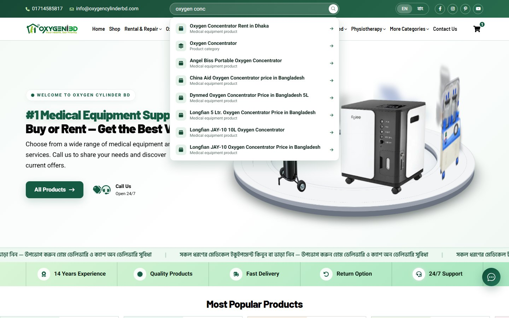
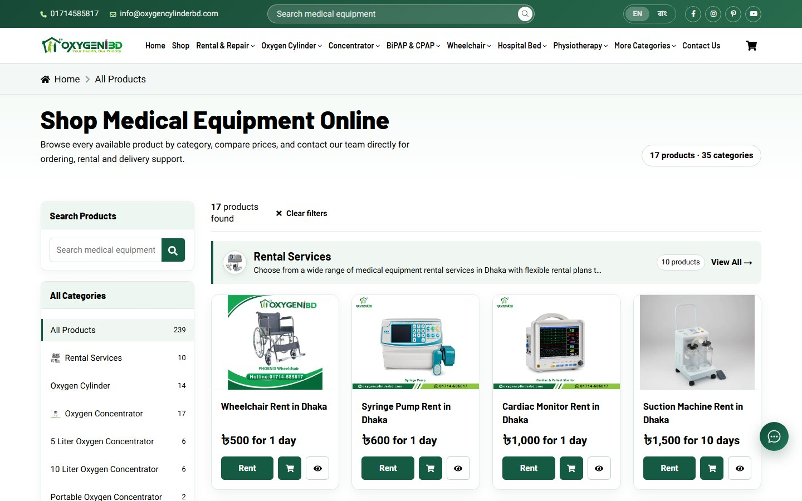
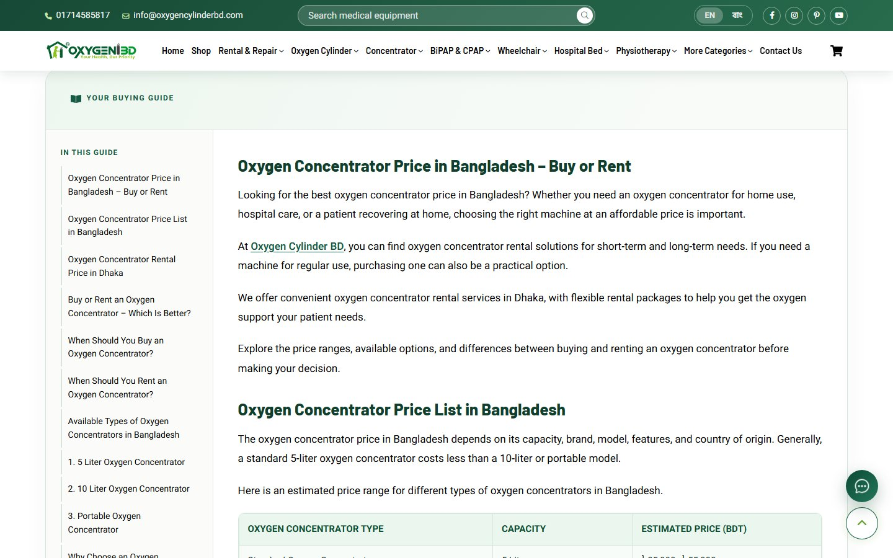
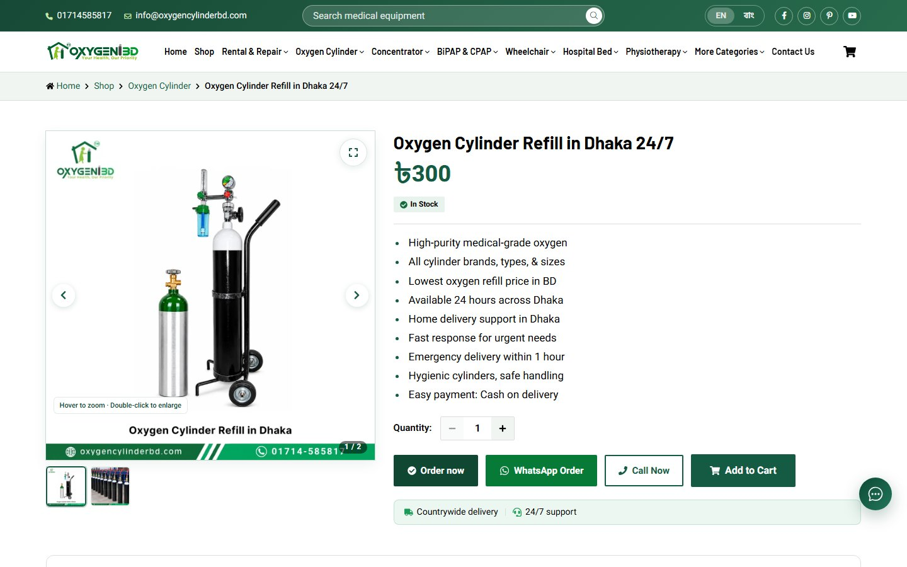
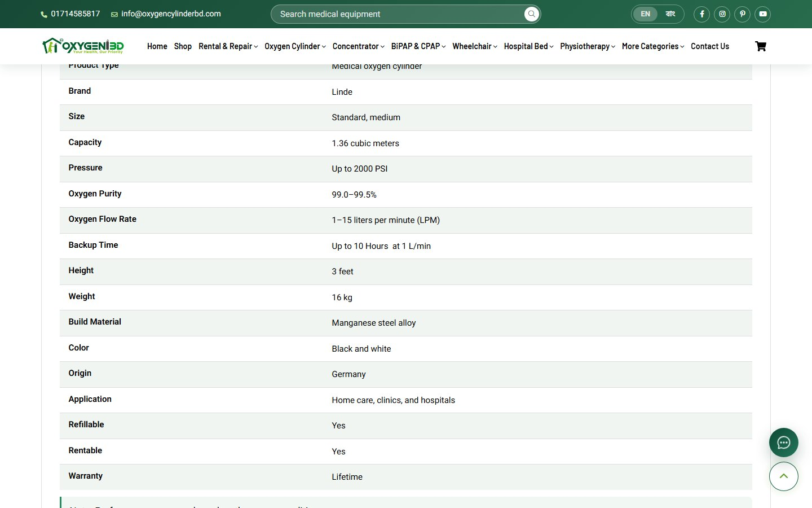

# Feature catalogue

> Every public and admin capability, grouped by area. Deeper explanations are linked from each section. [Back to the overview](../README.md)

## Contents

- [Public storefront](#public-storefront)
- [Navigation and search](#navigation-and-search)
- [Catalogue pages](#catalogue-pages)
- [Product pages](#product-pages)
- [Cart and ordering](#cart-and-ordering)
- [Content pages](#content-pages)
- [Engagement and support](#engagement-and-support)
- [Language](#language)
- [Admin panel](#admin-panel)
- [Platform capabilities](#platform-capabilities)

## Public storefront

### Home page

| Section | What it does |
| --- | --- |
| Hero | Headline, call to action and a rotating 3D display of equipment |
| Marquee | A scrolling service message written in Bengali |
| Service highlights | Five highlight tiles (experience, quality, delivery, returns, 24/7 support) |
| Most popular products | A product slider, with add-to-cart on each card |
| Promotion | A campaign banner with a live countdown |
| Shop by category | Image cards for the main categories, managed in the admin panel |
| Top rated and best selling | Product sliders |
| Rental showcase | A 3D carousel of rental products, with links to rental plans and the hotline |
| Why choose us | Reasons with a managed full-bleed video |
| How ordering works | Four steps: browse, ask, confirm, arrange delivery |
| Guidance call-to-action | Call or email for help before ordering |
| Blog journal | The latest article and more reads |
| Brands and partners | A logo marquee |
| FAQ | Common questions in an accordion |
| SEO overview | A long-form introduction behind a "show more" control |

<table>
  <tr>
    <td width="50%"> Rental showcase</td>
    <td width="50%"> Promotion with a live countdown</td>
  </tr>
</table>

## Navigation and search

- **Mega menu**: Home, Shop, eight product dropdowns and Contact Us. Six of the dropdown headings also open their category page; the mixed groups (Rental & Repair, More Categories) are dropdown-only. Short header labels are defined separately from category names.
- **Resilient links**: menu items are resolved against the live catalogue (exact slug first, then previous slugs) and have fallbacks, so a renamed category never breaks the menu.
- **Mobile drawer**: Menu and Category tabs, language switch, phone, email and social links.
- **Live search**: header suggestions for products and categories as you type, linking straight to the result.
- **Breadcrumbs** on every inner page, also published as `BreadcrumbList` structured data.

## Catalogue pages

| Feature | Detail |
| --- | --- |
| Shop page (`/shop`) | All products grouped by category, each group led by up to 8 products picked in the admin panel |
| Category pages | Title and introduction, products in the order set in the admin panel, and a buying guide below |
| Filters | Price bands with live counts, a custom min/max price, in stock, rentable, refillable, on sale |
| Sorting | Default order, newest, oldest, price low to high, price high to low, biggest discount, name A–Z, name Z–A |
| Shareable state | Filters and sorting live in the URL |
| Load More | Batches of 25 products, so pages stay light |
| Buying guides | A long-form guide with a table of contents, tables and images |
| Badges | "Best seller", "New" and custom badges with their own colours; struck-through regular prices |

<table>
  <tr>
    <td width="50%"> Rentals only, sorted by price (state kept in the URL)</td>
    <td width="50%"> Buying guide with a table of contents</td>
  </tr>
</table>

## Product pages

| Feature | Detail |
| --- | --- |
| Gallery | Square images, hover zoom, full-screen view, thumbnails |
| Service tabs | Buy, Rent and Refill, shown only when the product offers them |
| Rental packages | Fixed packages with prices ("For 5 days ৳6,000") |
| Status chips | In stock, rentable, refillable |
| Summary | Short bullet points |
| Actions | Order now, WhatsApp order, call now, add to cart |
| Trust strip | Countrywide delivery, 24/7 support |
| Specifications | Structured specification tables |
| Description | A rich document with headings, tables, images, YouTube video, and charts and shapes; an optional table of contents |
| Old URLs | Renamed products redirect permanently from every previous URL |

<table>
  <tr>
    <td width="50%"> Refill product</td>
    <td width="50%"> Specifications</td>
  </tr>
</table>

## Cart and ordering

- Cart drawer from any page and a full cart page with an order summary.
- Purchase, rental and refill lines together in one cart.
- Guest checkout with cash on delivery; the delivery fee is shown per item as free or to be confirmed.
- Alternatives at every step: WhatsApp order with a prefilled message, and call to order.
- An order number after checkout, with the team notified by email.

Details: [commerce and orders](COMMERCE_AND_ORDERS.md).

## Content pages

| Page | Features |
| --- | --- |
| Knowledge Centre (`/blog`) | Article cards with Load More, categories, English and Bengali articles |
| Article | Reading time, author and date, featured image, key takeaways, body with table of contents, recent articles, categories, sharing |
| FAQ | Search, categories, accordion, `FAQPage` structured data |
| About | Mission, vision, the founder's message |
| Contact | Call and WhatsApp actions, support topics, contact cards, an enquiry form |
| Career | Open positions managed in the admin panel |
| Policies | Privacy, terms and conditions, warranty, delivery, return and refund, how to buy, Affiliate Program |
| 404 | A branded not-found page, reached only after every legacy URL rule has been tried |

## Engagement and support

| Feature | Detail |
| --- | --- |
| Live chat | Anonymous sessions that survive a reload; staff reply from the admin panel; either side can end the chat |
| Contact form | Validated, rate-limited, with a honeypot; the visitor's consent time is recorded; replies are emailed from the team inbox |
| Mobile contact bar | Call, WhatsApp and Location, pinned to the bottom of the screen |
| Back to top | On long pages |

## Language

- **EN | বাং** switch in the header and the mobile drawer, remembered in a cookie.
- One URL per page in both languages; old `/bn` links redirect.
- Bengali typography (Hind Siliguri) and line spacing.
- Machine translation of published copy through an allowlist, cached in the database, with English as the fallback.

Details: [localization](LOCALIZATION.md).

## Admin panel

| Area | Features |
| --- | --- |
| Access | Sign-in with rate limiting; Super Admin, Admin and Content Admin roles; role-filtered navigation |
| Dashboard | Pending orders, unread messages, open chats, catalogue and media counts, visitor summary |
| Products | Category cards with counts, drag-and-drop ordering per category, multi-category placement, duplication, importing a description from another product, drafts, specifications pasted from spreadsheets |
| Categories | Content studio, buying guide, public URL changes that keep the old URL, icons, SEO; the locked All Products category |
| Pages | Studios for the Home, About, Blog index, Contact, Career, FAQ and Footer pages |
| Legal pages | Seven documents with approval states |
| Blog | Post list with SEO health badges; editor with images, takeaways, tags, slug history and review |
| Document editor | A Word-style ribbon editor saved as structured blocks |
| Media Library | Upload, search by file or page, usage inspection, image details, safe cleanup |
| Orders | Counters, tabs, filters, search, forward-only status, payment, delivery quote, rental return, email retry |
| Live chat and inbox | Real-time visitor chat; a team inbox with priority, status and emailed replies |
| Redirections | Rules with status codes, query modes, hit counts and loop protection |
| SEO workspace | Overview, parameters, page inventory, content audit, Search Console, GA4, visitor analytics, Core Web Vitals, publication results, structured data, operations checklist |
| Project Audit | Read-only health checks with saved snapshots and follow-ups |
| Settings | Brand, contacts, logos, favicon, search appearance |
| Feedback | Error modals that explain causes and remedies |
| Language | The admin panel's own English/Bengali switch |

Details: [content management](CONTENT_MANAGEMENT.md).

## Platform capabilities

| Capability | Summary | Read more |
| --- | --- | --- |
| SEO runtime | Indexable page registry, dynamic sitemap and robots, JSON-LD on every page, custom schema, URL history | [SEO and structured data](SEO_AND_STRUCTURED_DATA.md) |
| Legacy URL continuity | WordPress page map, historic post paths, a strict legacy product matcher, managed redirects | [WordPress migration](WORDPRESS_MIGRATION.md) |
| Media | GridFS storage, SEO file names, Range streaming, immutable caching, one set of details per image | [Architecture](ARCHITECTURE.md#media-pipeline) |
| Analytics | First-party, cookie-free, IP-free visitor analytics with bot filtering; GA4 dashboards | [Analytics](ANALYTICS.md) |
| Security | Deny-by-default roles, password-bound sessions, rate-limited public endpoints, safe content model | [Security architecture](SECURITY_ARCHITECTURE.md) |
| Operations | Gated releases, automatic rollback, dry-run-first migrations, nightly checksummed backups | [Deployment and operations](DEPLOYMENT_AND_OPERATIONS.md) |
