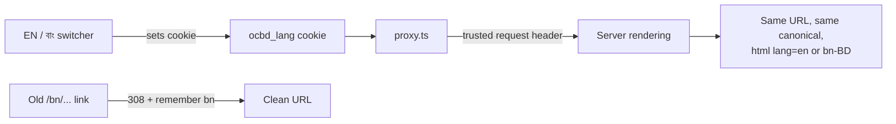
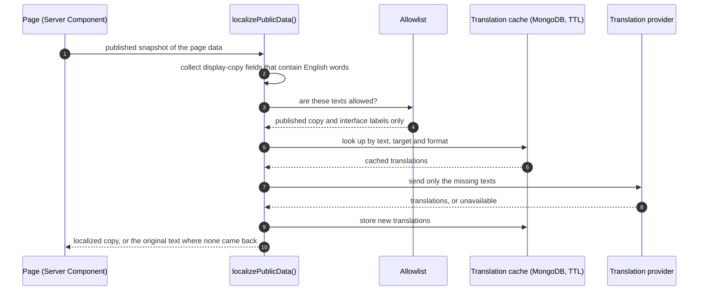

# Localization: English and Bengali

> How the site offers a Bengali interface without duplicate URLs, and how machine translation is kept away from private data. [Back to the overview](../README.md)

## Contents

- [Design goals](#design-goals)
- [One URL per page](#one-url-per-page)
- [How a Bengali page is produced](#how-a-bengali-page-is-produced)
- [The translation engine](#the-translation-engine)
- [What is never translated](#what-is-never-translated)
- [Client-side interface translation](#client-side-interface-translation)
- [The admin panel's own language](#the-admin-panels-own-language)
- [Typography](#typography)
- [Testing](#testing)
- [Operational notes](#operational-notes)

## Design goals

1. A visitor can switch between **EN** and **বাং** on any page, and the choice is remembered.
2. Search engines see **one canonical page**, not a second copy under a `/bn` path that would need canonical and `hreflang` management.
3. Private data (orders, chats, contact enquiries, drafts, account details) **never** reaches a translation provider.
4. A provider outage must never show broken text; the page falls back to English.
5. Translation costs stay predictable: text is translated once, cached, and only sent when it actually contains words in the other language.

## One URL per page

| Decision | Detail |
| --- | --- |
| Language preference | A cookie (`ocbd_lang`), read by the proxy on every public request |
| Passing it to the page | The proxy sets a request header for the server render. The browser can't set it directly, and admin requests have it removed |
| Caching | Responses vary on `Cookie`, so shared caches never serve one language's HTML to the other |
| Old `/bn/…` and `/en/…` links | Permanent 308 to the same path without the prefix; the cookie remembers the language the link implied |
| Metadata | Localized for display, but the canonical URL and indexability never change with the language |
| Sitemap | One entry per page; no `hreflang` alternates are needed |

An earlier version used `/bn/…` routes. Moving to one URL per page removed a whole class of duplicate-content and canonical problems, and the old links still work.

## How a Bengali page is produced

- The server translates a **copy** of the published data, never the stored source. Every cache lookup includes the source text, so an editor's next save automatically gets a fresh translation.
- Links and emphasis inside text are kept. Inline text is split into segments, translated, and reassembled with its link and emphasis ranges intact.
- Bengali copy that editors wrote by hand (for example, the home page's Bengali marquee) is shown exactly as written in both languages.

## The translation engine

The engine (`lib/translation/engine`) is provider-agnostic. The provider, cache and clock are passed in, so tests run offline and can never trigger a paid API call.

| Concern | Implementation |
| --- | --- |
| Provider | Google Cloud Translation v2, called only from the server, with a key used only by this site |
| Cache | MongoDB `translationcaches`, keyed by normalized text, target language, format and an engine version; a TTL index removes expired entries |
| Cache versioning | The engine version is part of every key. Changing protection or request rules invalidates old entries without a migration |
| HTML safety | Original markup is masked before sending and restored afterwards. The provider can't introduce executable HTML |
| Failure handling | Quota and permission errors are remembered longer than network blips, so a misconfigured key doesn't trigger a request storm |
| Partial results | The engine reports which inputs got no translation; those keep their original text |
| Language detection | "Needs translation" means the text contains letters of the other script. Bengali digits, the Taka sign (৳) and punctuation also appear in English prices, so they don't count |
| Protected tokens | Numbers, units, brands and model names pass through unchanged; units are matched as whole words so product names are never split. Text made only of such tokens is never sent |
| Request economy | Batches are de-duplicated, and simultaneous identical requests share one provider call. Text that already matches the target language costs nothing |
| Missing key | The engine warns once and serves the original text without making network calls |
| Run-time counts | Counts in labels ("246 published") are stripped before allowlist matching |

## What is never translated

| Category | Reason |
| --- | --- |
| Orders, chat messages, contact enquiries, drafts, account and settings records | Private data; these collections are never read by the translation layer |
| Identifiers, URLs, slugs, email addresses, phone numbers | They must stay exact |
| Technical specification values, prices, SKUs | Facts, not prose |
| Editor configuration and form input values | They belong to the user's input |
| Code, and elements marked private or non-translatable | Excluded in the renderer |

The `/api/translate` route used by the client accepts only **allowlisted** text: interface labels from the repository, and copy from the same published records the site already shows. It is same-origin only, rate-limited and size-limited.

## Client-side interface translation

Some interface text is rendered by client components (labels, buttons, tooltips). The `AutomaticTranslation` component handles it:

- It translates rendered text **in place**, never replaces nodes that React owns, and never touches input values.
- Switching back restores the original text exactly.
- Translations are shared across the tab, so client-side navigation doesn't re-request or flash text it already translated, and they are kept in storage for a week so returning visitors see labels at once.
- Visitor-entered text, editors, code, and anything marked `data-private` are skipped.

The list of translatable interface strings is a **generated catalogue**: a build step extracts it from the source on every `dev` and `build` run, and a test fails if it is out of date.

## The admin panel's own language

Staff can switch the admin panel to Bengali on its own cookie (`ocbd_admin_lang`). Their choice doesn't change the public site's language for visitors. In the admin panel, only repository-owned labels are translated. Record values in tables and forms are treated as data, while tags, badges and buttons inside them are still translated as labels.

## Typography

Bengali text uses **Hind Siliguri**, loaded with `next/font` alongside Roboto (public) and Poppins and Rubik (admin), with a system Bengali font as fallback. When the page language is Bengali, the language stylesheet switches the font family and opens up line height for the script (1.4 for headings, 1.75 for body text). Bengali slugs on legacy articles are matched in any percent-encoding.

## Testing

| Suite | What it proves |
| --- | --- |
| Routing (8 tests) | Every public page family has both languages on one clean address, WooCommerce trailing slashes included; query strings, hashes and encoded slugs survive; private, transactional, external, asset and unknown paths are never localized; prices and digits never count as Bengali; canonical overrides are matched by route and no `hreflang` alternates are published |
| Engine (14 tests) | De-duplication and caching; independent cache keys for source and language changes; API errors keep the original text, are never cached and report what is missing; quota errors back off; a missing key makes no network calls; brands, models, units and numbers survive; translated HTML can't add executable markup; identical simultaneous requests share one call |
| Catalogue (9 tests) | The generated catalogue is normalized, unique and free of credentials or URLs; admin scope allows only static labels and never reads the database; public pages expose only public fields; the page cache stays bounded under arbitrary anonymous paths; failures never admit arbitrary input |
| Browser | A headless Chrome run switches languages on real pages with translation responses mocked, so it never bills the provider |

## Operational notes

- Bengali copy depends on a configured translation provider. Without one, pages render in English with `lang="bn-BD"` and the Bengali typography. Visitors see readable English instead of errors.
- A cache-warming script (`translation:warm`) pre-translates published copy after a provider key is configured, so the first Bengali visitors don't wait for translations.
- Machine translation is a draft aid. Medical, legal and pricing copy that matters in Bengali should be reviewed by a person before it is relied on.
