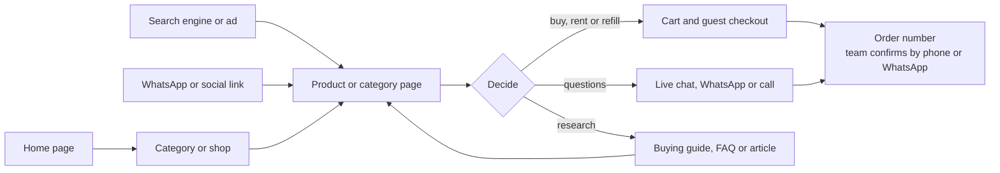
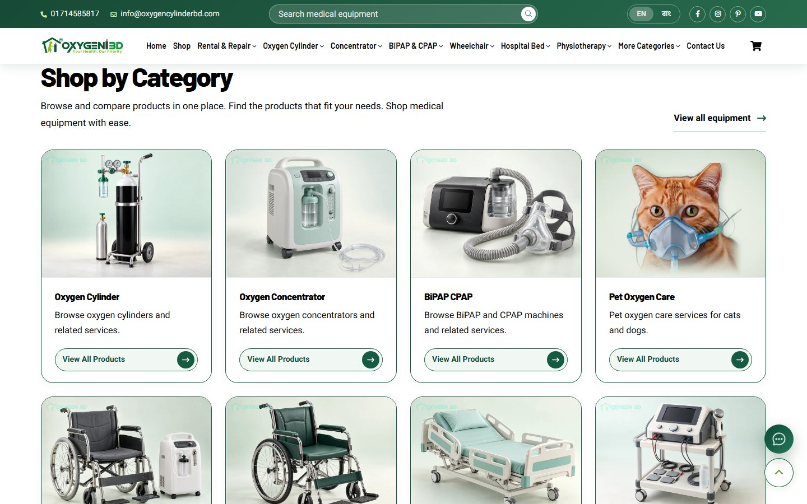
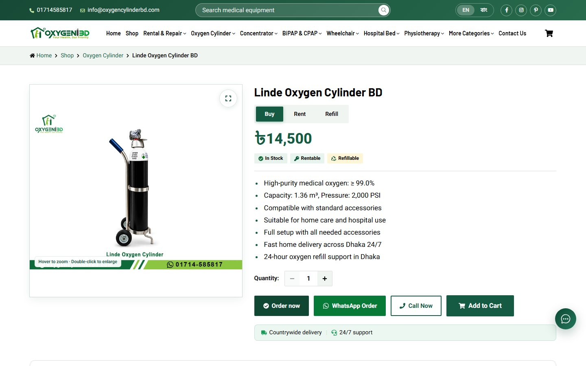
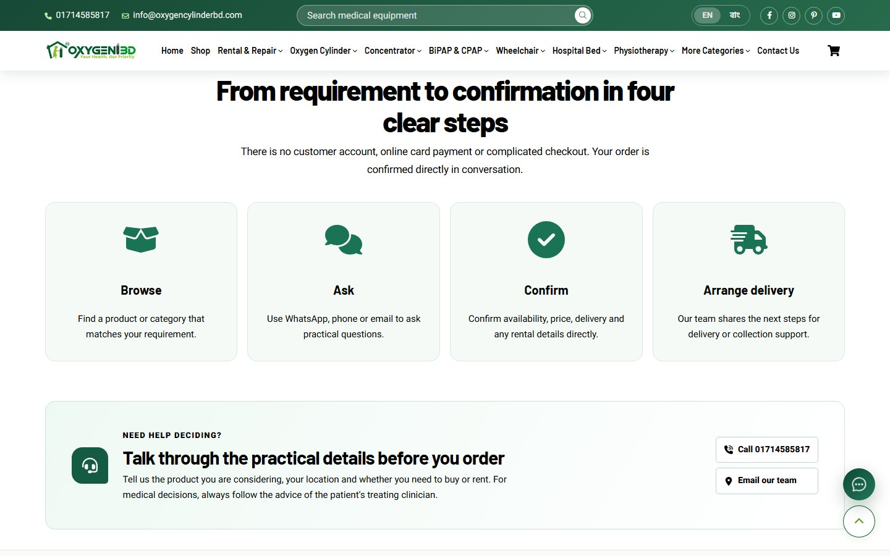
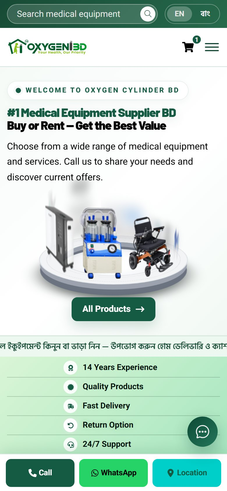
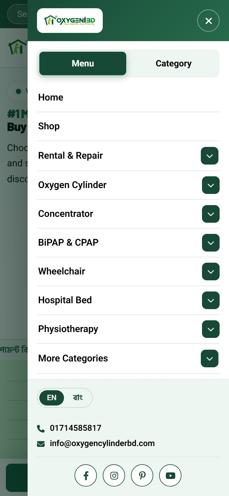
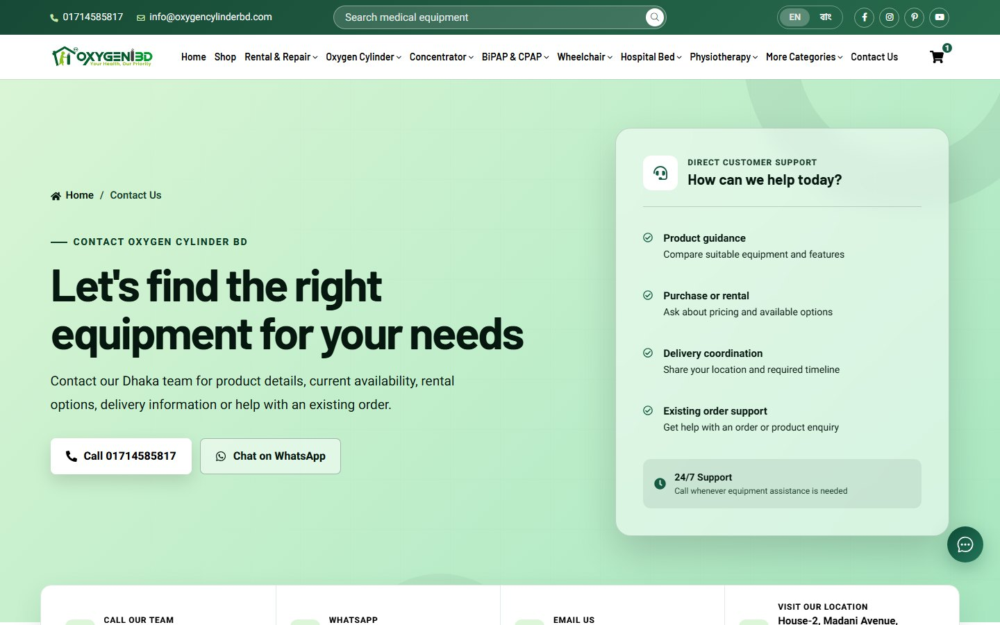

# Product overview

> Who the site serves, what they come to do, and how the product supports each journey. [Back to the overview](../README.md)

## Contents

- [The business](#the-business)
- [Audiences](#audiences)
- [Visitor journeys](#visitor-journeys)
- [Service model](#service-model)
- [Product domains](#product-domains)
- [Support channels](#support-channels)
- [Content that builds trust](#content-that-builds-trust)
- [Medical information](#medical-information)
- [Who maintains the content](#who-maintains-the-content)

## The business

Oxygen Cylinder BD is a medical-equipment supplier based in Dhaka. It sells, rents and refills oxygen equipment, and supplies hospital beds, mobility aids, respiratory devices, diagnostics and home-care products, with delivery across Bangladesh. Many orders are urgent: a patient is being discharged, or someone needs oxygen at home tonight. The website has to answer three questions quickly: *do you have it, what does it cost to buy or rent, and how fast can I get it?*

## Audiences

| Audience | What they need |
| --- | --- |
| Families and caregivers | Find the right equipment fast, understand buy versus rent, reach a person immediately |
| Patients managing long-term conditions | Refills, accessories, reliable service, clear prices |
| Clinics, nursing homes and care teams | Equipment for a care setting, rental for short-term needs, dependable delivery |
| Pet owners | Oxygen support for cats and dogs (a dedicated service) |
| The company's staff | Keep the catalogue, prices and guides accurate; respond to orders and enquiries |

## Visitor journeys

### Find the equipment

Visitors arrive on a product or category page from search, from the home page's category cards, or from the mega menu. The menu has eight product dropdowns (for example Oxygen Cylinder, Concentrator, BiPAP & CPAP, Wheelchair, Hospital Bed and Physiotherapy). The header search suggests products and categories while the visitor types. The shop and category pages filter by price band, stock, rental and refill availability, and sort eight ways.

### Choose how to get it

The product page shows each available service option as a tab: **Buy**, **Rent** (with fixed packages such as 5, 10 or 30 days) or **Refill** (with a price range). Specifications, a full description and delivery notes sit below.

### Get guidance

Category pages end in a **buying guide** with a table of contents: price lists, buy-or-rent comparisons and what to ask before ordering. The blog ("Knowledge Centre"), the FAQ and the information pages (warranty, delivery, return and refund, how to buy) answer the practical questions.

### Order or talk to someone

The visitor can check out as a guest with cash on delivery, send the cart as a WhatsApp message, call, or open a live chat. Whichever route they take, the team confirms availability, the delivery fee and the timing in conversation.

<table>
  <tr>
    <td width="33%"> Find: category cards on the home page</td>
    <td width="33%"> Choose: buy, rent or refill</td>
    <td width="33%"> Order: four clear steps</td>
  </tr>
</table>

## Service model

| Option | How it works | Example |
| --- | --- | --- |
| Buy | A purchase price, sometimes with the regular price struck through; some items are "contact for price" | An oxygen cylinder with a full setup |
| Rent | Fixed packages chosen on the product page; the rental services category is rent-only | An oxygen concentrator for 5, 10 or 30 days |
| Refill | A refill price range per cylinder | Oxygen cylinder refill in Dhaka, 24/7 |
| Delivery | Free on selected products; otherwise confirmed by the team | Shown per item at checkout |
| Payment | Cash on delivery | No online payment |

## Product domains

The live catalogue (35 categories, 239 published products on 26 Nov 2026) covers:

| Domain | Examples |
| --- | --- |
| Oxygen therapy | Medical oxygen cylinders (several brands and sizes, portable and travel), cylinder refills, oxygen concentrators (5 L, 10 L, portable), nitrous oxide cylinders, respiratory accessories |
| Respiratory and monitoring | BiPAP and CPAP machines, suction machines, nebulizers, pulse oximeters, patient and cardiac monitors, blood pressure machines, glucometers |
| Beds and patient care | Hospital beds, air mattresses, over-bed tables, bed backrests, medical stretchers |
| Mobility | Manual and electric wheelchairs, patient walkers |
| Physiotherapy | TENS machines, infrared lamps, body massage machines |
| Clinical and home care | Surgical instruments, hospital and lab equipment, hygiene and personal care, home health and wellness |
| Rental services | Oxygen cylinder, concentrator, BiPAP/CPAP, suction machine, wheelchair, hospital bed, cardiac monitor and syringe pump rental |
| Other | Pet oxygen service; used medical equipment |

The live catalogue is always the authoritative source for products, prices and availability.

## Support channels

| Channel | Where |
| --- | --- |
| 24/7 hotline | Header, footer, product pages, cart, checkout, mobile contact bar |
| WhatsApp | Product pages ("WhatsApp Order"), cart, checkout, contact page, mobile contact bar |
| Live chat | A floating chat on every public page, answered from the admin panel |
| Contact form | The contact page, delivered to the team inbox |
| Location | A "Location" button in the mobile contact bar |

<table>
  <tr>
    <td width="25%"> Mobile: call, WhatsApp and location always one tap away</td>
    <td width="25%"> Mobile navigation: menu and category tabs</td>
    <td width="50%"> Contact page: product guidance, purchase or rental, delivery, existing orders</td>
  </tr>
</table>

## Content that builds trust

- **Buying guides** on category pages: prices, buy-or-rent comparisons and practical questions.
- **Knowledge Centre articles** in English and Bengali, with reading time, key takeaways and related articles.
- **Policies** written for customers: privacy, terms, warranty, delivery, return and refund, how to buy, Affiliate Program.
- **About and career pages**: mission, vision, the founder's message, open positions.

## Medical information

Product descriptions and articles are general information. Equipment choice, therapy settings and patient care should follow a qualified clinician and the manufacturer's instructions. The site says this where it matters, and the admin panel has a **medical review** state for copy that touches patient care.

## Who maintains the content

Authorized staff maintain the catalogue, prices, guides, pages and policies in the private admin panel (see [content management](CONTENT_MANAGEMENT.md)). Staff work in three roles: Super Admin, Admin and Content Admin. Customer records, internal workflows and unpublished content are not part of this showcase.
