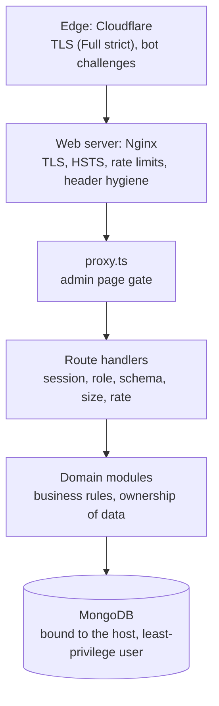

# Security architecture

> The controls that protect the admin panel, customer data and the public site, from the edge down to individual fields. [Back to the overview](../README.md) · [Security policy](../SECURITY.md)

This document describes design and practice. It doesn't publish configuration values, server details, internal paths or the results of internal audits.

## Contents

- [What is being protected](#what-is-being-protected)
- [Layers](#layers)
- [Admin authentication](#admin-authentication)
- [Sessions](#sessions)
- [Authorization](#authorization)
- [Public endpoints](#public-endpoints)
- [Content and output safety](#content-and-output-safety)
- [Redirect safety](#redirect-safety)
- [Media](#media)
- [Secrets and configuration](#secrets-and-configuration)
- [Transport and hosting](#transport-and-hosting)
- [Supply chain](#supply-chain)
- [Privacy by design](#privacy-by-design)
- [Built-in auditing](#built-in-auditing)

## What is being protected

| Asset | Main risks |
| --- | --- |
| The admin panel | Account takeover, privilege misuse, cross-site request abuse |
| Catalogue and content integrity | Unauthorized edits, injected markup, broken or hijacked links |
| Customer order and enquiry data | Disclosure, tampering, leaking to third parties |
| Media | Unsafe uploads, accidental deletion of files still in use |
| API keys and paid quotas | Theft, abuse that runs up costs |
| Availability | Abuse of public endpoints, dependency vulnerabilities |

## Layers

Each layer assumes the one in front of it can fail. The proxy is only a fast page gate, so every route handler checks authorization again. Handlers validate input even though the browser forms already do.

## Admin authentication

| Control | Implementation |
| --- | --- |
| Where accounts live | In the server's protected environment, not in the database. There is no sign-up, invitation or password-reset flow to attack. Up to nine accounts are supported |
| Password storage | scrypt hashes (`N = 2^15, r = 8, p = 1`). Hashes are rejected unless their cost parameters, salt and key lengths fall within safe bounds |
| Password policy | At least 12 characters |
| Creating a hash | A script reads the password from a hidden prompt, not from a command-line argument, so it never lands in shell history or the process list |
| Comparisons | Constant-time comparison everywhere a secret is compared |
| Timing | Every login path performs exactly one scrypt derivation, so response time doesn't reveal whether an email exists |
| Brute force | Login is limited to 10 attempts per 15 minutes per client, answered with `429` and `Retry-After` |
| Error messages | One generic "Invalid email or password" for every failure |

## Sessions

| Property | Value |
| --- | --- |
| Token | JWT signed with HS256 (jose), with issuer, audience and subject checked on every verification |
| Lifetime | 7 days |
| Cookie | `httpOnly`, `SameSite=Lax`, `Secure` in production |
| Signing secret | At least 32 characters, enforced by the environment schema at start-up. Rotating it signs every administrator out |
| Password binding | The token carries a keyed digest of the account's current password. Changing a password revokes every session for that account at once |
| Role binding | The role in the token must still match the configured account. Changing a role invalidates old sessions |
| Verification | One function, shared by the proxy and the route handlers |

## Authorization

| Role | Scope |
| --- | --- |
| Super Admin | Everything, including deleting media and running media cleanup |
| Admin | Everything except Super Admin–only media actions |
| Content Admin | Page content, legal pages, products, categories, blog and FAQ, with publish but not unpublish, and no delete |

- **One source of truth.** A single module defines roles, page prefixes and UI permissions. The proxy, the API guards and the sidebar all import it.
- **Deny by default.** Admin route handlers are wrapped in `withAdmin` (full admins), `withContentAdmin` (opt-in for content roles), `withSuperAdmin` or a capability check. A handler without an explicit opt-in is closed to Content Admins.
- **Publishing asymmetry.** Content Admins may publish a draft but may not take live content offline. That needs a full admin.
- **UI mirrors the API.** Buttons for deleting, unpublishing and maintenance are hidden for roles that can't use them, and the API refuses those actions anyway.

## Public endpoints

| Endpoint | Guards |
| --- | --- |
| Place an order | 10 requests per 15 minutes per client; 48 KB body cap; Zod schema; prices rebuilt on the server; idempotency key with a unique index |
| Contact enquiry | Same-origin only; 10 per 15 minutes; 8 KB body cap; Zod schema; a honeypot field; consent time recorded |
| Live chat | New sessions 20 per minute; polling 30 per minute and messages 15 per minute per session |
| Search suggestions | 480 per minute per client |
| Translation | Same-origin only; 120 per minute; allowlisted text only |
| Visitor beacon | Same-origin only; 120 per minute; 4 KB body cap; always answers `204` |

**Trusting client addresses.** Rate limits key on the client address. The application only trusts forwarded-address headers when it is configured to run behind a proxy that overwrites them. Otherwise anyone could rotate a forged header to escape a limit. The limiter's memory is bounded and evicts the oldest entries first.

## Content and output safety

| Risk | Control |
| --- | --- |
| Stored cross-site scripting | Rich content is stored as typed blocks and text ranges, never as HTML. The renderer builds elements from data |
| Malicious paste | Pasted documents go through an allowlist parser: only known elements are read, and scripts, styles and attributes are dropped |
| Unsafe links | Inline links are character ranges whose destinations must be a site path (never protocol-relative), an in-page anchor, `mailto:`, `tel:` or an `http(s)` URL; anything else, including `javascript:`, is rejected. Typography marks accept only an allowed set of values |
| Unsafe images in content | Image sources must come from the site's own media routes or origin |
| Breaking out of JSON-LD | Custom schema is parsed, normalized and written with every `<` escaped, so it can't close its `<script>` element |
| Untrusted translation output | Original markup is masked before translation and restored afterwards; the provider can't add executable HTML |
| Over-sized or malformed input | Content, settings, order, contact and redirect routes validate request schemas with Zod; uploads have their own type and size checks; public JSON bodies are read through a size-bounded reader |

## Redirect safety

The staff-managed redirect system is safe even if a record is altered outside the admin API:

- The destination must be a path on the **same host**: no protocol-relative or external URLs.
- Only 301, 302, 307 and 308 are honoured.
- A rule can't redirect a path to itself, and the admin API refuses circular chains and duplicate sources.
- The lookup has a 1-second time limit and **fails open**: if the redirect store is unavailable, the request continues normally instead of failing.
- Redirect responses are `private, no-store`.

## Media

- Uploads are checked for type and size (images 10 MB, documents 25 MB, videos 60 MB) and get a unique public file name, so an upload can never replace another file's URL.
- Deleting files, bulk deletion and cleanup are Super Admin actions.
- Automatic cleanup only removes a file when it can prove that no content references it. Any error or uncertainty keeps the file.
- Download headers encode non-ASCII file names safely (RFC 6266), and media is served with explicit content types.

## Secrets and configuration

- Secrets live only in a protected environment file on the server, outside the repository. The application validates them with a Zod schema at start-up and refuses to run with missing or weak values.
- Modules that handle secrets import `server-only`, so the build fails if one of them is pulled into browser code.
- Google OAuth tokens and the GA4 service-account key are **encrypted at rest** with a dedicated key, and the admin panel never displays a stored key again.
- No third-party API key is ever sent to the browser. Translation, analytics, Search Console and PageSpeed are called from the server.

## Transport and hosting

| Control | Detail |
| --- | --- |
| Edge | Cloudflare proxies the domain, with Full (strict) TLS to the origin and challenges for traffic from cloud-hosting networks commonly used by bots |
| HTTPS | Let's Encrypt certificates at the origin; HTTP and the apex domain redirect to `https://www.` in one hop |
| HSTS | `Strict-Transport-Security: max-age=31536000` |
| Header hygiene | No `X-Powered-By`; server tokens disabled; unknown host names rejected |
| Isolation | The application and the database listen only on the host itself; Nginx is the only public listener |
| Database access | Authentication on, with a least-privilege user for the application |
| Service | A systemd service under an unprivileged account, with a read-only home and write access limited to the application folder |

## Supply chain

- Dependencies are installed with `npm ci` from the lockfile in a clean build.
- The release gate stops if `npm audit` reports findings or any test fails.
- Next.js 16.4 also refuses to build a framework version with known advisories, which the gate treats as a blocker.
- Advisories are acted on as release blockers. In this project: Next.js 16.3 → 16.4.3 and Nodemailer 7 → 10.2 before go-live (October 2026), Zod above the affected range, and Next.js 16.4.6 with Mongoose 9.11.4 in November 2026.

## Privacy by design

| Data | Handling |
| --- | --- |
| Orders | Only what delivery needs: name, phone, address, district, optional email, preferred contact method |
| Contact enquiries | The time of the visitor's consent is recorded |
| Analytics | No cookies; no IP addresses; daily-salted hashes; 400-day automatic expiry |
| Translation | Orders, chats, enquiries, drafts and account data are never sent to a provider |
| Screens and screenshots | Personal fields are marked `data-private` in the UI; public screenshots in this repository are redacted |

## Built-in auditing

The admin panel's **Project Audit** runs read-only checks of security, reliability, performance, architecture and integrations. Examples are session-secret strength, how admin passwords are stored, and response security headers. Runs can be saved as snapshots, and findings carry follow-up status, owner and notes. The audit writes only to its own history collections; it never changes content, orders or server configuration.

Findings and their status are internal and are not published here. To report a vulnerability, follow the [security policy](../SECURITY.md).
