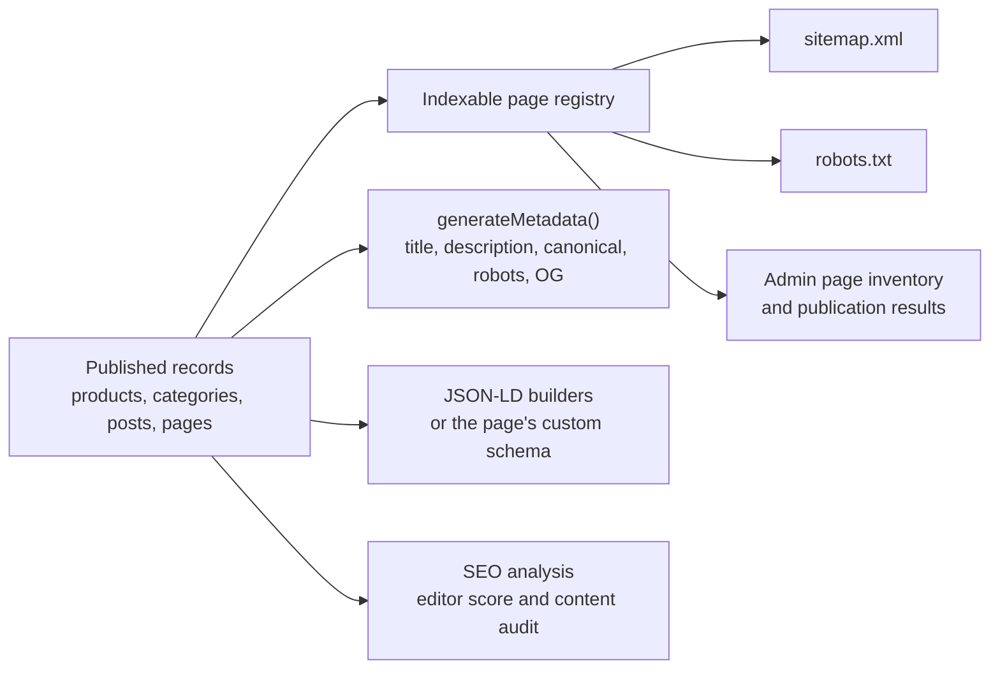
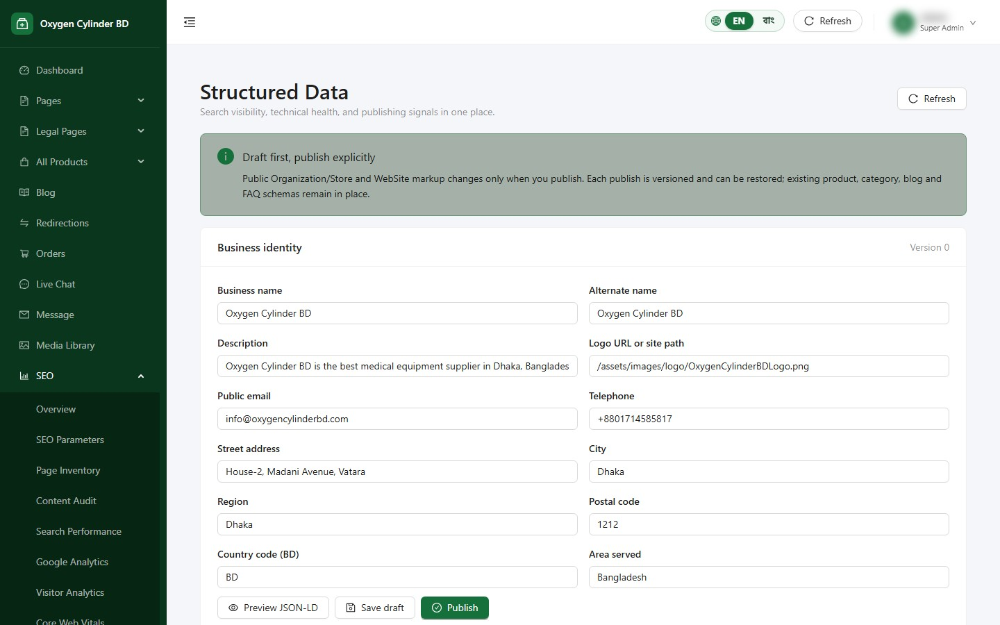
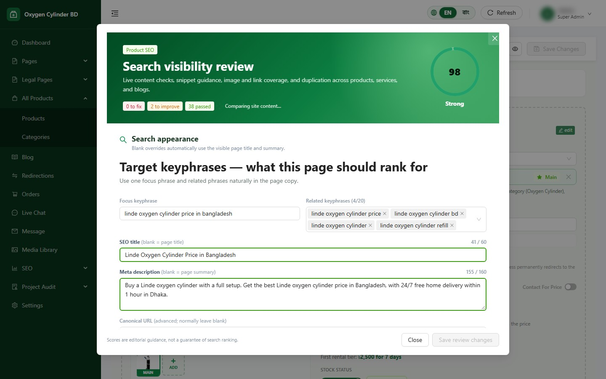
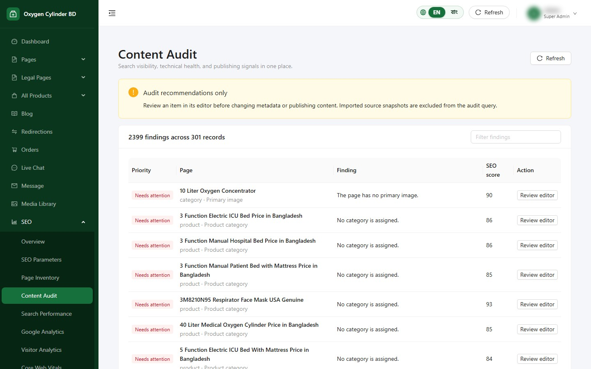
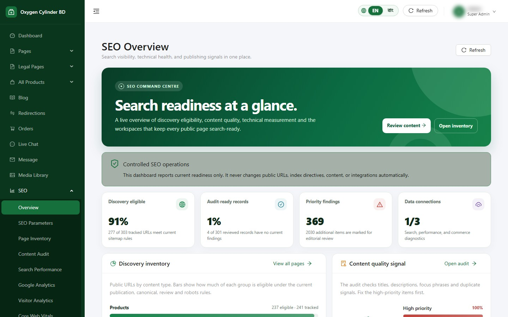
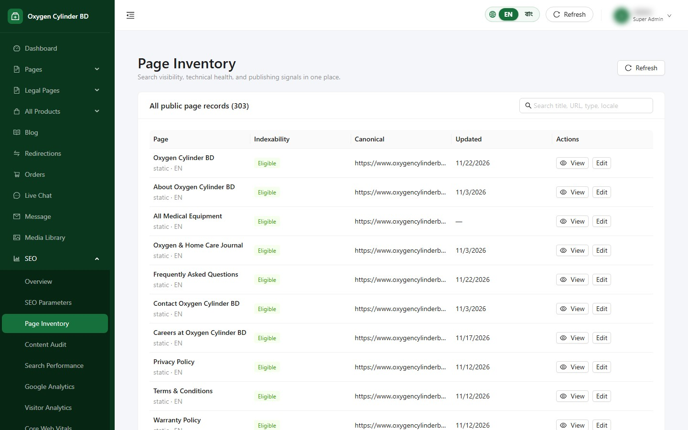

# SEO and structured data

> How search discoverability is built into the runtime, the content model and the admin workflow. [Back to the overview](../README.md)

The live figures below were read from `www.oxygencylinderbd.com` on **26 November 2026**.

## Contents

- [Principles](#principles)
- [Page metadata](#page-metadata)
- [The indexable page registry](#the-indexable-page-registry)
- [Sitemap](#sitemap)
- [robots.txt and AI crawlers](#robotstxt-and-ai-crawlers)
- [Structured data](#structured-data)
- [Custom schema per page](#custom-schema-per-page)
- [URL continuity](#url-continuity)
- [Content analysis](#content-analysis)
- [The SEO workspace](#the-seo-workspace)
- [What SEO here doesn't claim](#what-seo-here-doesnt-claim)

## Principles

1. **One source of truth per question.** Which pages are indexable, what a product URL looks like, and which schema a page publishes are each answered by exactly one module.
2. **Decide on the server.** Canonical URLs, `noindex`, redirects and JSON-LD are settled before any client code runs.
3. **Editors can fix what they can see.** Every finding points at a field the editor can change. Findings that need a developer are labelled that way.
4. **Never invent signals.** Ratings, reviews and other trust markup are only published when the data behind them is real.



## Page metadata

Every public route produces its metadata from the same record it renders:

| Element | Source and rule |
| --- | --- |
| Title | The record's SEO title, or the visible title when that is blank |
| Meta description | The SEO description, or the page introduction or summary when that is blank |
| Canonical | Self-referencing by default, built by the shared URL helper. WooCommerce-style trailing slashes are kept for product and category pages. An editor can set an override |
| Robots | `noindex` and `nofollow` per record; cart and checkout are also excluded by an HTTP header and by `robots.txt` |
| Open Graph and Twitter | SEO overrides, then page-sharing values, then the record's featured image and copy |
| `metadataBase` | Set from the configured public origin, so every relative URL resolves to `https://www.oxygencylinderbd.com` |
| Verification | The Search Console verification tag is rendered from configuration, and a verification file is served |

Live check (26 Nov 2026): product pages publish a canonical link, Open Graph image tags and a Twitter card. `/cart` responds with `X-Robots-Tag: noindex, nofollow`.

## The indexable page registry

`getIndexablePageRegistry()` builds the complete inventory of public pages from products, categories, blog posts and managed pages. It loads route and publication fields only, never bodies or images. Each entry records whether the page is indexable and, if not, why:

| Exclusion reason | Meaning |
| --- | --- |
| `unpublished` | The record is hidden |
| `noindex` | An editor chose `noindex` |
| `review-incomplete` | Editorial or medical review hasn't reached a publishable state |
| `route-incomplete` | The page can't be built yet (for example a missing slug) |
| `canonical-points-elsewhere` | The canonical override names another URL, so this page isn't the primary copy |

A page is indexable only when **all** gates pass. The same registry feeds the sitemap, the `robots.txt` AI-crawler rules, the admin Page Inventory and Publication Results, and the content audit. The numbers can't disagree between screens.

## Sitemap

- Generated per request (`force-dynamic`) with a 12-second query limit, so a slow database can never break a production build.
- `lastmod` comes from each record's update time. Priority: home 1.0, static pages 0.8, categories and posts 0.7, products 0.6. `/blog` is marked daily.
- If the database is unavailable, the sitemap falls back to the fixed pages that are known to be indexable, instead of returning an error.
- One URL per page. Both languages share the same URL, so the sitemap needs no `hreflang` alternates.

**Live sitemap, 26 Nov 2026:** 276 URLs: 238 products, 26 categories, 8 static pages and 4 blog articles, all with `lastmod`.

## robots.txt and AI crawlers

```text
User-Agent: *
Allow: /
Disallow: /admin/
Disallow: /api/
Disallow: /cart
Disallow: /checkout

User-Agent: GPTBot
User-Agent: OAI-SearchBot
User-Agent: ClaudeBot
User-Agent: PerplexityBot
User-Agent: CCBot
… (14 AI user agents in one group)
Allow: /
Disallow: /admin/  /api/  /cart  /checkout
Disallow: /<each page an editor marked noindex>$
```

- **Private paths** are closed to every crawler.
- **Pages marked `noindex`** are also withheld from AI crawlers, using exact-path rules (`$` and `?` variants). Search engines aren't blocked from those pages: they must be able to fetch them to see the `noindex`.
- **Never fail closed.** Crawlers treat a failing `robots.txt` as a reason to stop crawling, so the route never errors. If the `noindex` lookup misses a 3-second deadline, it serves the last list it read. The lookup keeps running and refreshes the list for the next request. The list lives on `globalThis`, so it survives Next.js reloading the module.

## Structured data

Every page renders its JSON-LD through one component, `PageStructuredData`, fed by shared builders in `pageSchemas.ts`. The admin panel's automatic-schema view calls the same builders, so what an editor sees is exactly what the page publishes.

| Page type | Schema |
| --- | --- |
| Every page | Site-wide `@graph`: `Organization` + `Store` (logo `ImageObject`, `PostalAddress`, `ContactPoint`, area served) and `WebSite` |
| Product | `Product` with `Brand` and `Offer` (price, currency, availability) and `BreadcrumbList` |
| Category and `/shop` | `CollectionPage` with an `ItemList` of products, plus `BreadcrumbList` |
| Blog article | `BlogPosting` (headline, author, dates, image) and `BreadcrumbList` |
| FAQ | `FAQPage` with `Question` and `Answer`, built from the visible questions only |
| Contact | `ContactPage` |
| Other pages | `WebPage` with breadcrumbs |
| 404 | None |

The site-wide identity (name, logo, contacts, address, area served) is edited in **SEO → Structured Data**. Changes are saved as a draft, previewed as JSON-LD, then published explicitly. Each publish is versioned, and any earlier revision can be restored.

Live check (26 Nov 2026), a product page: three JSON-LD blocks with `Organization`, `Store`, `WebSite`, `Product`, `Brand`, `Offer` and `BreadcrumbList`.



## Custom schema per page

Every SEO Review, on products, categories, posts, the shop page, managed and legal pages and the FAQ, contains a **Structured data (Schema JSON-LD)** field.

| Behaviour | Detail |
| --- | --- |
| Starting point | The field shows the page's complete automatic JSON-LD |
| Saving a custom schema | That page then publishes exactly the custom schema, replacing the automatic output, on that page only |
| No accidental override | Text that matches the automatic schema (formatting ignored) stays automatic, so the page keeps following its content |
| Accepted input | An object, an array, or pasted `<script type="application/ld+json">` blocks; each block needs `@context` and `@type` or `@graph` |
| Errors | Invalid JSON or missing keys are refused, with a message the editor can act on |
| Output safety | The schema is stored normalized and written with every `<` escaped, so pasted text can't close the `<script>` element |
| Reset | **Reset to automatic** removes the override |

The refactor that introduced this field moved the builders out of the pages unchanged. JSON-LD from 19 live page types was compared before and after the release, and all blocks were identical.

## URL continuity

| Layer | What it catches |
| --- | --- |
| Slug history | Renamed products and posts (`previousSlugs`) and changed category URLs (`previousPublicSlugs`) redirect permanently to the current URL |
| Managed redirects | Staff-defined rules in **Redirections**: same-host destinations, 301/302/307/308, exact or ignored query strings, hit counts, loop and duplicate protection |
| Legacy WordPress map | Known WordPress-era pages and plugin redirects that have no page of their own |
| Legacy product matcher | Old product slugs that differ only in a rotated location or price ending (for example `-price-in-bd` and `-price-in-bangladesh`) go to the one published product with that name |
| Legacy query search | `/?s=term` from the WordPress search goes to the shop search |
| Locale prefixes | `/bn/…` and `/en/…` links go to the clean URL |

The details and the migration story are in [the WordPress migration case study](WORDPRESS_MIGRATION.md).

## Content analysis

One shared analysis module scores a record the way its public page renders it. It runs in the editor's SEO Review, in the site-wide content audit, and on the SEO overview.

| Area | Checks |
| --- | --- |
| Keyphrases | Focus phrase in the title, introduction, a heading, the URL, the meta description and image alt text; coverage of related phrases |
| Snippet | Title and description length bands; duplicate SEO titles across the site |
| Structure | Heading outline (one H1, no skipped levels); URL structure; search intent |
| Copy | Content length for the page type; duplicate titles, descriptions and copy across the site |
| Links | Internal links, outbound links, broken links, orphan pages |
| Images | Primary image present; alt text present, meaningful and not duplicated; modern formats; complete metadata; no embedded data-URI images |
| Discoverability | Schema prerequisites for the page type; social card inputs |
| Governance | Content freshness; editorial review; medical review |
| Domain rules | Rental-service products have valid rental packages; products are assigned to a category |

<table>
  <tr>
    <td width="50%"><br /><sub>The SEO Review inside an editor</sub></td>
    <td width="50%"><br /><sub>The site-wide content audit</sub></td>
  </tr>
</table>

## The SEO workspace

| Screen | Purpose |
| --- | --- |
| Overview | Share of URLs that are eligible for discovery, audit-ready records, priority findings, connected data sources |
| SEO Parameters | The metadata and discovery signals the site implements, plus suggested next steps |
| Page Inventory | Every public record with its indexability, canonical URL, last update, and links to view or edit |
| Content Audit | Findings across all records, by priority, each linking to the right editor |
| Search Performance | Google Search Console data through OAuth; tokens stored encrypted |
| Google Analytics | GA4 reports through a service account (see [analytics](ANALYTICS.md)) |
| Visitor Analytics | First-party analytics with bot and data-center filtering |
| Core Web Vitals | PageSpeed Insights runs on chosen pages and strategies, saved as history: performance, SEO, accessibility and best-practice scores; LCP, CLS, INP, FCP, TTFB, TBT |
| Publication Results | Eligible URLs with any Search Console signals |
| Structured Data | Site-wide identity schema: draft, preview, publish, restore |
| SEO Operations | A safeguarded publishing checklist |
| Merchant Center | Optional product diagnostics when an account is connected |

Every screen in the workspace reports and recommends. None of them changes public URLs, index directives, content or integrations automatically.

<table>
  <tr>
    <td width="50%"><br /><sub>SEO overview</sub></td>
    <td width="50%"><br /><sub>Page inventory</sub></td>
  </tr>
</table>

## What SEO here doesn't claim

- A good score means the signals the application can check are present. It doesn't predict rankings, and the interface says so.
- Duplicate checks compare this site's own records; they are not a plagiarism check against the web.
- Site-wide properties (page speed, mobile layout, analytics) are measured by their own tools, not scored per record.
- No review or rating markup is published, because the site doesn't collect verified reviews.
