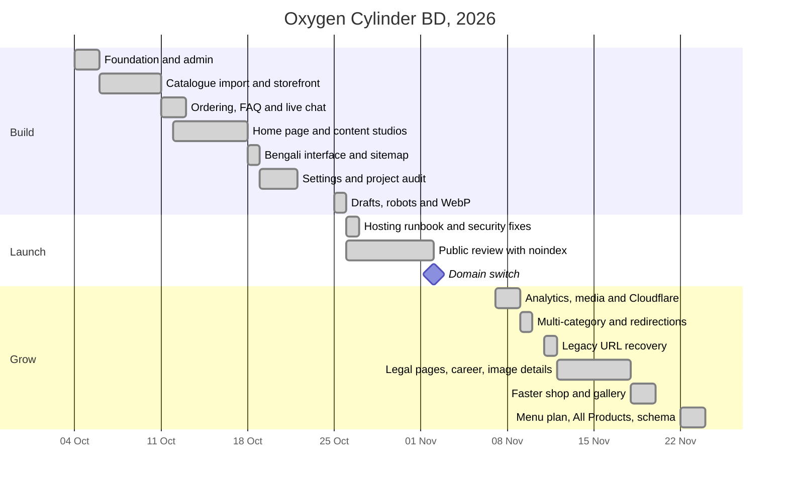

# Delivery timeline

> From the first commit to a live, migrated store in 29 days, then four more weeks of growth. Dates come from the private repository's commit history (128 commits, 4 Oct to 25 Nov 2026) and the deployment log. Production releases sometimes followed a commit by a day. [Back to the overview](../README.md)

## Overview

## Week by week

### 4–11 October: foundation, catalogue and ordering

| Date | Milestone |
| --- | --- |
| 4 Oct | Next.js App Router foundation, admin sign-in and dashboard, and the shop module, based on an earlier healthcare platform |
| 6 Oct | Blog migration and editorial workflow; the public blog served from MongoDB |
| 7 Oct | Home page layout; branded header and navigation |
| 8 Oct | **The live WooCommerce catalogue imported** (37 categories, 247 products, images in GridFS); categories consolidated; product and category pages served from the catalogue |
| 10 Oct | About and Contact pages; the home page built from the real catalogue and blog; template leftovers removed |
| 11 Oct | Home and About page studios; the product page rebuilt; **guest cart, checkout and orders** |

### 12–18 October: content, catalogue depth and language

| Date | Milestone |
| --- | --- |
| 12 Oct | FAQ page and **live chat**, both with admin screens; always-visible header search; mobile navigation drawer |
| 13 Oct | Shop by Category with its editor; the site's 404 page; a managed video section |
| 14 Oct | Diagnostics showcase; company offers |
| 15 Oct | Page content studio improvements; footer payment logos |
| 16 Oct | Editor for the home page SEO overview |
| 17 Oct | **Category content studio**, buying guides and advanced product filters; `/shop` becomes the main catalogue page |
| 18 Oct | **English/Bengali localization** and the sitemap and robots rules; promotion with a countdown |

### 19–31 October: hardening and the review deployment

| Date | Milestone |
| --- | --- |
| 19 Oct | About page with mission, vision and the founder's message |
| 20 Oct | Dashboard statistics; site settings; the **Project Audit** workspace |
| 25 Oct | Editor drafts, WebP content images, robots controls, slug-based blog URLs |
| 26 Oct | Hosting and data-migration runbook; **security upgrades** (Next.js 16.4.3, Nodemailer 10.2.1); redirects for former WordPress URLs; one URL per page for both languages; **first deployment to the production server** on a public review address with `noindex` |
| 27 Oct | Page sharing (Open Graph) and image metadata controls |
| 29 Oct | Table blocks; media inventory; privacy and terms pages |
| 31 Oct | SEO Parameters dashboard; category editor with slug-based URLs |

### 2–8 November: go-live

| Date | Milestone |
| --- | --- |
| **2 Nov** | **Domain switch: `www.oxygencylinderbd.com` served by the new application.** Contact inbox; richer document editing |
| 3 Nov | Expanded page content management and blog publishing |
| 4 Nov | Video in product content |
| 5 Nov | Blog articles restyled as guides |
| 7 Nov | Media file-name hardening; rent-only rental services; rentals priced from packages |
| 8 Nov | **First-party visitor analytics**, the GA4 module and Media Library fixes; the domain moved behind **Cloudflare** |

### 9–17 November: operations and continuity

| Date | Milestone |
| --- | --- |
| 9 Nov | **Multi-category products**, editable category URLs and the **Redirections** module; explanatory error modals; product duplication and content import; incremental loading in admin lists |
| 10 Nov | Editable site footer; orphaned uploads removed after content saves |
| 11 Nov | **Old WordPress product URLs recovered** with the strict legacy matcher, after the Search Console follow-up |
| 12 Nov | Legal pages at their requested URLs; the legacy path resolver runs before any 404 |
| 15 Nov | Collapsible guidelines and tables of contents |
| 16 Nov | Super Admin restrictions for media; file names kept in step across editors and the Media Library |
| 17 Nov | Career page; **one set of image details per image** across the site |

### 18–25 November: speed and polish

| Date | Milestone |
| --- | --- |
| 18 Nov | Performance audit; **Load More** in batches of 25; up to 8 products per category on `/shop`; square product gallery; richer dashboard statistics |
| 19 Nov | Project Audit and SEO workspace upgrades |
| **22 Nov** | **Six production releases in one day**: the approved header menu plan; menu headings that open their categories; a compact desktop menu; the protected **All Products** category; **custom JSON-LD in every SEO Review**; category pages in the admin's order. Also Next.js 16.4.6 and Mongoose 9.11.4, public uploads served by file name, and the bundled company logo |
| 23 Nov | Product tables of contents made opt-in; header link styling |
| 25 Nov | Named media URLs accepted when saving products |

## By the numbers

| Measure | Value |
| --- | --- |
| Calendar time to go-live | 29 days (4 Oct → 2 Nov) |
| Commits | 128 (77 features, 15 fixes, plus documentation, chores and styling) |
| Production releases on 22 Nov alone | 6 |
| Automated tests at 25 Nov | 103 |
