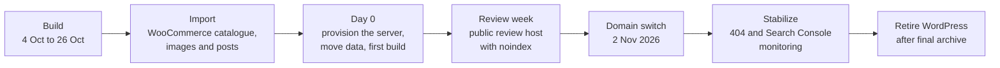
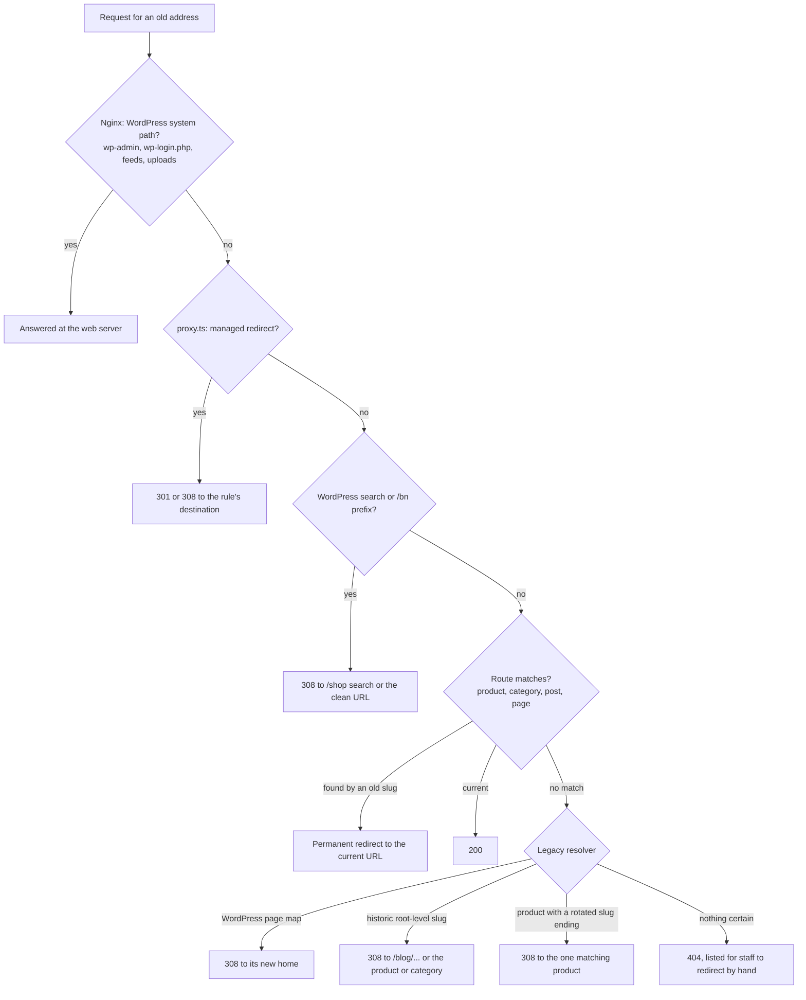

# Case study: replacing a WooCommerce site without losing its search history

> How a live WordPress/WooCommerce store was moved to a Next.js application on the same domain while keeping its URLs, content and search visibility. [Back to the overview](../README.md)

## Contents

- [Starting point](#starting-point)
- [Goals and constraints](#goals-and-constraints)
- [Migration in phases](#migration-in-phases)
- [Moving the catalogue and content](#moving-the-catalogue-and-content)
- [Keeping every URL working](#keeping-every-url-working)
- [Cutover](#cutover)
- [After the switch: the Search Console follow-up](#after-the-switch-the-search-console-follow-up)
- [Living with a content team that edits production](#living-with-a-content-team-that-edits-production)
- [Results](#results)
- [Lessons](#lessons)

## Starting point

Until 2 November 2026, `www.oxygencylinderbd.com` was a WordPress site with WooCommerce and Yoast SEO. Years of product pages, category pages and articles had been indexed under WooCommerce URL shapes, and several plugins quietly hid old addresses: a "404 to similar post" plugin and a redirection plugin.

The new application was built in a separate repository from 4 October 2026. It reuses the architecture, admin conventions and storefront page designs of an earlier Next.js healthcare platform, restyled in the Oxygen deep-green theme.

## Goals and constraints

| Goal | Constraint |
| --- | --- |
| Keep every indexed product and category URL working | WooCommerce uses `/product/<slug>/` and `/product-category/<slug>/`, with trailing slashes |
| Move the catalogue, images and articles without retyping them | The live site kept changing during the build |
| Leave no gap in service | The business takes orders every day |
| Be able to undo the switch quickly | The old site had to stay recoverable |
| Don't let the old site's plugin behaviour quietly disappear | Plugins had been masking hundreds of old addresses |

## Migration in phases

Each phase in the private runbook ends with a **gate**: a checklist that must pass before the next phase starts. Decisions that belonged to the owner, such as when to switch, which old URLs go where, and when WordPress may be removed, were recorded as numbered decisions rather than assumed.

## Moving the catalogue and content

| Step | Detail |
| --- | --- |
| Read-only export | An export ran on the WordPress server and only read from it. Database credentials never left the WordPress configuration, and image files were read as an archive. The import supported a dry run with a report, and the first real import backed up the catalogue it replaced |
| Catalogue import | The live WooCommerce catalogue at the time, **37 categories and 247 products**, was imported with its images stored in GridFS |
| What each product kept | The permalink slug and **every retired slug** (WordPress's old-slug records and the redirection plugin's rules); the Yoast title, meta description, focus keyphrase, canonical, robots and Open Graph values; primary and additional categories; tags; SKU; sale and regular prices; buy, rent and refill pricing with rental-duration variations; stock; featured flag; badge; view count; menu order; and images with their alt text |
| Content conversion | Long descriptions became editor blocks; short descriptions became specification rows plus a summary. Records in older shapes are converted on demand and only rewritten when someone saves them |
| Provenance | The complete WordPress record and the raw HTML are kept on each product for traceability and later repairs; rendering never uses them |
| Re-sync | A `--refresh` mode re-synced imported fields from WordPress during the build, without re-creating anything an admin had deleted |
| Blog import | WordPress posts were imported with their historic paths, so old article URLs could be resolved |
| Category consolidation | Categories were consolidated and given buying guides, icons and SEO fields in the new studio |
| Data move to production | The development database was archived, checksum-verified, test-restored as a dry run, restored to the server database and verified: about **1,700 documents and 660 images (69 MB)** at the time |

Deliberate deletions are recorded as **tombstones**, so running an import or seed script again can never bring back a product the team removed.

## Keeping every URL working

URL continuity is handled in layers, from the cheapest check to the most specific:

| Layer | Examples |
| --- | --- |
| Kept URL shapes | `/product/linde-oxygen-cylinder-price-in-bangladesh/` works with or without the trailing slash (`skipTrailingSlashRedirect`); the canonical URL keeps the WooCommerce form |
| Slug history | Renamed products, posts and category URLs keep their old values and redirect permanently |
| WordPress page map | `/custom-checkout/` → `/checkout`, `/my-account/…` → `/`, `/wishlist/` → `/shop`, `/blog-posts/` → `/blog`; post tag, category and date archives → `/blog`; author archives → `/about-us`; paginated category pages → the category page; product tags → the matching category |
| Historic post paths | Root-level WordPress post slugs, including Bengali slugs in any percent-encoding, resolve to `/blog/<slug>` |
| Search and language | `/?s=oxygen` → `/shop?search=oxygen`; `/bn/<path>` → `/<path>` |
| Managed redirects | Staff can add rules in **Admin → Redirections** without a release |

Before the switch, every URL class was requested from a local production build, and the results were compared against the live WordPress inventory: pages, products, categories, query strings, pagination, feeds, archives and system paths.

## Cutover

| Step | Detail |
| --- | --- |
| Review host | The application ran publicly on a separate review address with `noindex` for a week of testing and content work |
| Final backup | A final, checksum-verified archive of the WordPress database and files |
| Switch | The web server configuration for `www.oxygencylinderbd.com` was pointed at the new application in a quiet hour. **Rollback was one configuration reload** |
| Verification | Every redirect variant reached `https://www.oxygencylinderbd.com` in one hop; TLS and HSTS were in place; `noindex` was gone; the smoke test of legacy URLs passed |
| WordPress | Kept intact but no longer served on the public domain, so the switch stayed reversible |

## After the switch: the Search Console follow-up

In the second week after the switch, Search Console reported a **"Server error (5xx)"** issue. The investigation on 11 November found:

- The two failing URLs were errors from the **old WordPress site before the switch** (a maintenance-mode 503 and a 500). The Next.js application had served no public 5xx response since 2 November.
- The real gap was elsewhere. WordPress's "similar post" plugin had been 301-redirecting old product slugs whose location ending the content team had rotated (`-price-in-bd`, `-price-in-bangladesh`, `-in-dhaka`…). The new site returned 404 for them, and **117** such URLs had received Googlebot requests.

The fix was a deliberately **strict** legacy product matcher:

- Strip up to two known location or price endings from the requested slug.
- Match only when the remaining name is identical to a published product's name **and exactly one product** shares it.
- Otherwise return a real 404, and list the URL for staff to decide in the Redirections module.

That rule covered about **180** historic URLs with a permanent 308 redirect. The uncertain remainder (85 URLs) went to the owner as a reviewed list, instead of being guessed. The matcher has its own test suite.

## Living with a content team that edits production

The content team started editing the live catalogue on the day of the switch, and production data soon diverged from development. Some practices kept that safe:

- **Production is read-only to developers.** Changes reach production through guarded migration scripts, never by hand.
- **Inspect production before shipping data-dependent features.** For example, the team had created categories whose URLs were retired aliases of other categories. A strict alias check in the multi-category release would have blocked those saves, and it was relaxed before release.
- **Mirror on request.** A sync script copies the live catalogue into the development database. It refuses any target except the development database, dry-runs by default, writes in one transaction, and carries the deletion tombstones across.
- **Expect samples to go stale.** Release smoke tests use sample URLs, and staff rename things. When a check fails, it is re-run against the previous release before the new code is blamed.

## Results

| Measure | Outcome |
| --- | --- |
| Cutover method | A web-server configuration reload in a quiet hour; no maintenance page |
| Public 5xx responses from the new application since the switch | None found in the November investigation |
| Product and category URL shapes | Unchanged |
| Old product URLs recovered by the strict matcher | About 180, with permanent redirects |
| Live sitemap on 26 Nov 2026 | 276 canonical URLs with `lastmod` |
| Ability to undo the switch | Kept until the owner retires WordPress |

## Lessons

1. **Inventory what plugins were silently doing.** The riskiest behaviour of the old site wasn't on any page; it was in redirect plugins.
2. **Prefer a strict automatic rule plus a reviewed list** to a fuzzy matcher. A wrong redirect is worse than an honest 404 that staff can fix.
3. **Make the switch reversible and cheap.** A one-reload rollback made it possible to switch on a fixed day without fear.
4. **Treat production data as the source of truth** once a content team is working in it, and build tools that read from it safely.
